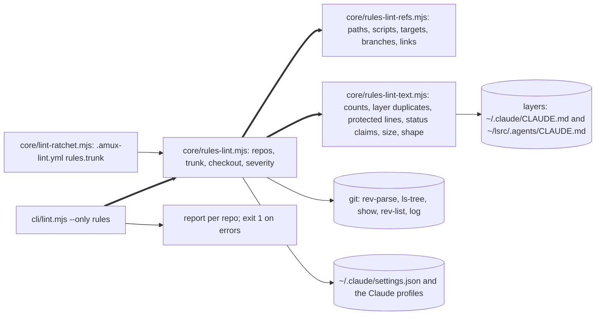
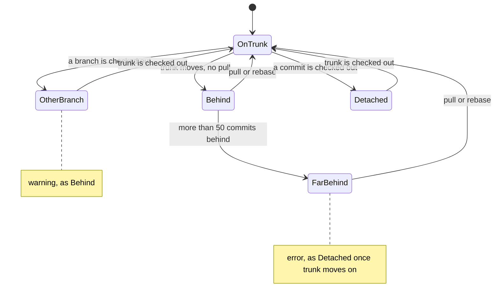

# amux lint --only rules: the repos' rule files checked against trunk

Version: 3 · 2026-10-20 17:4xZ · owner of the design: api:0 · page: none yet
<!-- stale: -->

## 1. Goal

lsrc:0's order to api:0 of 20 Oct 07:5xZ, from his request in the daily log 2026-10-20 ("lsrc:0: Claude läser nu
repots AGENTS.md"). He asked whether the repos' rule files are still needed, named the global layer the most
important, and said the repo files may be outdated and must become trustworthy and fixed. At 07:14:57Z and
07:17:39Z he asked for them to be linted and fixed; lsrc:0's reading in the same log puts this lint in scope at P2,
after the search release, narrowed to ai:0's ten checks and with no new tool stage. ai:0's audit of 17 repos
the same morning (`~/lsrc/.artifacts/rules-audit-2026-10-20/INDEX.md`) found KEEP 415, DUP 22, DUP-PARTIAL 22,
STALE 33, CONFLICT 1 and FLAG 116. Most STALE rows were dead paths, scripts and targets, and the audit lists ten checks
a tool could run.

The outcome:

1. `amux lint --only rules [repo...]` runs the audit's ten checks, plus the check that Claude loads each repo's
   AGENTS.md, and prints the findings per repo. It exits 1 when any error is found.
2. One run over the 18 repos, with its findings in §10.

Principles, in the order they decide:

1. An error is certain. It names the ref, the line and what is missing. Everything heuristic is a warning.
2. Read-only. The lint never edits, fetches, deletes or rewrites a rule file, a ref or a checkout.
3. Trunk decides what exists; the working tree shows what panes load.
4. His words are protected: listed, never proposed for deletion.
5. Reuse `amux lint`: its targets, its report and its baseline.

Non-goals:

- No fixes. Owners edit their files; the audit's per-repo pages already say how.
- No schedule in v1 (§14), no network, no duplicate search across languages (word runs only), and no check of
  `amux` subcommand names.

## 2. UX

n/a: a command-line tool with no screens. The report follows `amux lint`'s form. New strings:

| Place | Product text | Max length | Stage |
|---|---|---|---|
| `amux lint --help` | `--only contract\|rules    Select one check; rules runs only when named` | 80 | v1 |
| Repo header | `~/lsrc/swoop-sim · trunk origin/main, fetched 2026-10-20 09:36 · on main, 0 behind` | 110 | v1 |
| Error | ``✗ AGENTS.md:12 script `test:e2e` is not in any package.json on origin/master [exists]`` | 120 | v1 |
| Warning | ``⚠ AGENTS.md:142 `tests/e2e/parallel-pipeline.test.ts` is not on origin/master [path]`` | 120 | v3 |
| Warning | `⚠ .claude/CLAUDE.md:9 "72 task handlers" is a count that rots [count]` | 120 | v1 |
| Warning | `⚠ AGENTS.md:40 repeats the shared layer, .agents/CLAUDE.md:14 (0.81) [layer-dup]` | 120 | v1 |
| Info | `ℹ AGENTS.md: 6 protected lines, his dated words [protected]` | 80 | v1 |
| Machine line | `✗ ~/.claude/settings.json lacks cc-plugin-agents-md instructionFiles=claude-md-and-agents-md [reach]` | 120 | v1 |
| Summary | `18 repos · 12 errors · 41 warnings · 2.4 s` | 60 | v1 |

## 3. Use cases

- **UC-1 The full run.** api:0 runs `amux lint --only rules` with the 18 repo paths of §12.
  - Example: 18 repos, 21 rule files, 170 KB of rule text, the largest pl4n's AGENTS.md at 67 KB.
  - Result: a header and findings per repo, one summary line, exit 1 if any error exists.
  - Cost: no network and no money; *estimated* under 10 s (one `git ls-tree` per repo took 6 ms on skybar's 579
    files). Stage v1. Sequence: §5 seq-run.
- **UC-2 One repo, before a commit.** An agent edits `~/lsrc/swoop-sim/AGENTS.md` and runs
  `amux lint --only rules .` in the repo. Its findings only; exit 1 on an error. Stage v1. Sequence: §5 seq-run.
- **UC-3 A dead path.** Until d296191 today, decl-worker-api's AGENTS.md said
  `npx vitest run tests/e2e/parallel-pipeline.test.ts`, while 78d885e had moved the tests to `tests/component/`.
  The lint reports it as an error naming origin/master. Stage v1. Sequence: §5 seq-run.
- **UC-4 A checkout far behind.** `~/lsrc/skydive-altimeter`, the skyvw pane root, sat detached 1 277 commits behind
  origin/main from 21 Sep to 20 Oct (INDEX flag 2), so its panes loaded a 173-line AGENTS.md. The lint reports
  `✗ checkout detached at <sha>, 1277 behind origin/main [checkout]`. Stage v1. Sequence: §5 seq-run.
- **UC-5 A duplicate of a higher layer.** A repo line that repeats a shared-layer rule gets a warning naming the
  layer's line and the share of matching word runs. The tool never deletes it. Stage v1. No sequence: inside one
  process.
- **UC-6 His words.** A line with a quote plus a date or his name is listed as protected and is never a duplicate
  candidate. A protected line removed from trunk in the last 90 days, whose text exists nowhere else in the trunk
  tree, is an error naming the commit. Stage v1. Sequence: §5 seq-run.
- **Unhappy cases:**
  - Not a git repository (`~/lsrc`, skyreplay): one line, skipped, no error.
  - No remote (skydive-manifest): trunk falls back to the local main or master, and the header says so.
  - Remote refs not fetched for days: the header prints the fetch time; the lint never fetches.
  - A path on the machine (`~/...`, `/...`) is checked on the filesystem, not on trunk.
  - Example paths (a line with "e.g." or "for example") and placeholders (`<repo>`, `*`, `$X`): skipped.
  - A huge rule file (pl4n, 67 KB): read once; the size check warns.
  - Two runs at once: read-only, so no lock.
  - Cancel halfway: nothing was written.

## 4. Architecture



- Identity: a repo is its git top level (`git rev-parse --show-toplevel`). Its rule files are AGENTS.md, CLAUDE.md
  and .claude/CLAUDE.md at the top level; nested ones and the generated `.agents/` copies are out of v1. A finding is
  repo, file, line, check and token; the existing baseline fingerprints it.
- Layers for duplicates: `~/.claude/CLAUDE.md` and `~/.codex/AGENTS.md` (global), and `~/lsrc/.agents/CLAUDE.md`
  (shared, generated by `amux hints-sync`).
- Ownership: the lint writes nothing. A baseline file is written only by the existing `--update-baseline` path.
- One exit: n/a: nothing leaves the machine and nothing is written.
- Switches:
  - `--only rules` selects the check. Plain `amux lint` keeps running only `contract`, so commit gates do not change.
    `rules` exits 1 on any error with or without `--strict`, as lsrc:0 asked; `contract` keeps its `--strict` rule;
  - `rules.trunk` in a repo's `.amux-lint.yml` names its trunk when that is not origin/HEAD. skybar needs
    `origin/preview` ("Källan är git-grenen `preview`", its CLAUDE.md, while origin/HEAD is origin/main).
- Invariants:
  - **I-1** Read-only. Every git call goes through one `gitRead`, which allows only rev-parse, symbolic-ref,
    for-each-ref, ls-tree, show, cat-file, rev-list, log, grep, check-ignore and `config --get`. Enforced in `rules-lint.mjs`,
    guarded by `core/rules-lint.test.mjs`, "runs only read-only git commands".
  - **I-2** Errors are certain. Only these are errors: a script, target, branch, link or anchor missing on trunk; a
    CLAUDE.md that is a symlink, a copy or a link to AGENTS.md; a missing setting with no import; a checkout detached
    behind trunk or more than 50 commits behind; a protected line removed without a copy; a repo with only
    CLAUDE.md. Enforced by the severity table in `rules-lint.mjs`, guarded by "keeps heuristics as warnings".
    A missing path is a warning (v3: 1 of 26 was right), and a path the checkout's ignore rules cover is not
    reported; guarded by "warns on a missing path and skips one the checkout ignores".
  - **I-3** His words are never duplicate candidates. Enforced in `rules-lint-text.mjs`, guarded by
    `core/rules-lint-text.test.mjs`, "never lists a protected line as a duplicate".

## 5. Behaviour (UML)

```mermaid
%% id: seq-run
sequenceDiagram
  participant U as agent or api:0
  participant C as cli/lint.mjs
  participant R as rules-lint.mjs
  participant G as git
  participant F as rule files and layers
  U->>C: amux lint --only rules <repos> (UC-1 to UC-4, UC-6)
  C->>R: lintRules(repos)
  R->>F: settings.json and the Claude profiles, once
  loop each repo
    R->>G: rev-parse, symbolic-ref, rev-list: trunk and checkout
    R->>G: ls-tree -r trunk once; show trunk:package.json, Makefile and the rule files
    R->>F: working-tree rule files, what panes load
    R->>R: the ten checks on the trunk text
    R->>G: log -p --since=90.days trunk -- rule files; grep -F for moved lines
  end
  R-->>C: findings per repo
  C-->>U: report; exit 1 when an error exists
```



The lint itself keeps no state between runs; the diagram is the canonical checkout as each run classifies it.

## 6. Pseudocode

```
trunkOf(repo):                                        # rules-lint.mjs
  ref = .amux-lint.yml rules.trunk
        or origin/HEAD's target or origin/main or origin/master or main or master
  none -> the current branch, and the header says "no trunk ref"
  fetched = mtime of .git/FETCH_HEAD, or "never"
  # tests: rules-lint.test "follows origin/HEAD", "falls back to main without a remote", "reads rules.trunk"

checkoutState(repo, trunk):                           # rules-lint.mjs
  ahead, behind = rev-list --left-right --count HEAD...trunk
  detached and behind > 0 -> error;  behind > 50 -> error
  another branch or 1..50 behind -> warning
  for each rule file: working tree != trunk blob -> warning "panes load a different file", with the lines that differ
  # tests: "flags a detached checkout behind trunk", "warns on another branch", "warns on a loaded file unlike trunk"

references(line, before):                             # rules-lint-refs.mjs
  skip when line or the 2 lines before say "e.g.", "for example", "t.ex." or "example"
  for each backtick span and each line of an untagged or shell code block:
    `npm run X` | `pnpm [run] X` | `yarn X` | `bun run X`   -> script X
    `make X`                                                -> target X
    the word "branch" before it, or origin/<name>           -> branch
    has "/" or a known extension, no < > * { } $ or "..."   -> path, minus :line, #anchor and end punctuation
  markdown links [x](path#anchor) with a relative path      -> link
  # tests: rules-lint-refs.test "finds paths, scripts, targets and branches", "skips examples and placeholders"

exists(ref, repo, trunk, tree):                       # rules-lint-refs.mjs
  path ~/... or /...  -> on the filesystem
  path                -> in tree (one ls-tree -r of trunk, with directory prefixes), from the repo root
                         or from the rule file's directory
  script              -> any package.json in tree at trunk has scripts[X]
  target              -> a Makefile at trunk has a line "X:"
  branch              -> refs/heads/X or refs/remotes/origin/X
  link                -> the path exists, and the anchor equals a heading slug of that file at trunk
  # tests: "reports a missing path on trunk", "accepts a path that exists only on trunk",
  #        "reports a missing npm script and make target", "reports a link with a dead anchor"

layerDuplicates(file, layers):                        # rules-lint-text.mjs
  for each sentence with 8 or more words, not protected:
    share = |5-word runs in the sentence and in a layer| / |5-word runs in the sentence|
    share >= 0.6 -> warning with the best layer line and the share
  # tests: "flags a sentence the shared layer already has", "never lists a protected line as a duplicate"

protectedLines(file) and removedProtected(repo, trunk, file):   # rules-lint-text.mjs
  protected = a quote of 3 or more words, and a date YYYY-MM-DD or "Mattias" on the line
  removed = "-" lines of log -p --since=90.days trunk -- file that are protected, absent from the file at trunk,
            and absent from grep -F of the trunk tree
  removed -> error with the commit
  # tests: "lists his dated words as protected", "errors on a removed protected line",
  #        "accepts a protected line moved to another file"

claudeShape(repo, tree, setting):                     # rules-lint-text.mjs
  only CLAUDE.md, no AGENTS.md            -> error "Codex reads none of these rules"
  CLAUDE.md beside AGENTS.md: a symlink, the same text or a markdown link to it -> error
  CLAUDE.md beside AGENTS.md other than "@AGENTS.md" -> fine: Claude-only rules
  setting missing and no "@AGENTS.md"     -> error "Claude does not load AGENTS.md here"
  # tests: "errors on a symlinked or copied CLAUDE.md", "errors on a repo with only CLAUDE.md",
  #        "errors when neither the setting nor an import loads AGENTS.md"
```

Counts, status claims and size are single regular expressions in `rules-lint-text.mjs`: `\(\d+ lines\)` and
`\d+ (handlers|tests|components|files|commands)` warn [count]; "not deployed", "switched off" and "waits for" without
a date on the line warn [status]; a rule file over 30 KB warns [size]. Each has one test of the same name.

## 7. Platform limits

- Rule files: 21 in the 17 audited repos (16 under `~/lsrc` and `~/.openclaw/workspace`), 170 KB, from 930 B
  (g35-camera-system) to 67 005 B (pl4n). haunt-lab's checkout has none on its current branch. *Measured* (`stat`,
  07:4xZ).
- Trunk refs: 11 of the 18 repos have no origin/HEAD (cutkit, swoop-sim, pl4n, ai-gateway, skydive-manifest,
  haunt-lab, cad, agent-session-web, g35-camera-system, the OpenClaw workspace and agentmux). *Measured*
  (`git symbolic-ref`).
- Checkouts at 07:4xZ: skybar on preview, 507 ahead of and 4 behind origin/main; decl-atomic-ui 3 ahead and 1 behind;
  haunt-lab on design/first-concepts; g35-camera-system on feat/dual-camera-carrier; skydive-altimeter on main,
  0 behind, so flag 2 was fixed after the audit. *Measured* (`git rev-list --left-right --count`).
- Settings: one `~/.claude/settings.json`, which the three Claude profiles symlink to, holds
  `pluginConfigs["cc-plugin-agents-md@builtin"].options.instructionFiles = "claude-md-and-agents-md"`. *Measured*.
- Claude loads a repo's AGENTS.md with that setting: *measured* by lsrc:0 (daily log, a fresh `claude -p` in
  `skydive-altimeter/.agents/probe`, with and without). Whether "@AGENTS.md" plus the setting loads it twice is
  *assumed* harmless until the build's step 1 measures it: two `claude -p` runs that differ only in CLAUDE.md,
  compared by input tokens.
- git: `ls-tree -r --name-only origin/main` of skybar (579 files) took 6 ms. *Measured*. Remote refs are as last
  fetched: skybar 09:32 and skydive-altimeter 09:36 local today. *Measured* (FETCH_HEAD).

## 8. Alternatives

| Option | Cost per run | Build | Decided by | Reopen when |
|---|---|---|---|---|
| A. As today: an audit by agents | one Sonnet auditor per repo group plus a review, hours | 0 | the audit found mostly mechanical faults | never for the mechanical checks |
| B. A new command `amux lint-rules` | under 10 s | 5h | a second lint entry with its own targets, report and baseline | `amux lint` cannot take a second check |
| **C. `amux lint --only rules` (chosen)** | under 10 s | 5h | reuses targets (`--all-agents`, agent names, paths), the report and the baseline | |
| D. Duplicates by bge-m3 through the search daemon | under 1 min, 3 GB RAM | 2h more | needs the warm daemon for a lint | word runs miss duplicates that a reader finds |

The approach that already worked was ai:0's audit; C runs its mechanical half in seconds.

## 9. Risks

- **R-1 False errors on example paths make people ignore the lint.** Likely.
  - Mitigation: examples and placeholders are skipped, and errors only come from the certain classes (I-2).
  - Detection: every error of the full run is checked by hand against trunk (§12, Big input last).
  - Fallback: the baseline. Owner api:0.
- **R-2 A stale remote ref hides a checkout far behind.** Possible.
  - Mitigation: the header prints when the remote was last fetched.
  - Detection: "prints the fetch time of the trunk ref".
  - Fallback: `git fetch` in that repo, then run again. Owner api:0.
- **R-3 A duplicate warning is read as permission to delete his words.** Possible.
  - Mitigation: duplicates are warnings that say "repeats"; protected lines are never candidates (I-3).
  - Detection: "never lists a protected line as a duplicate".
  - Fallback: the history check (UC-6) flags a removed protected line. Owner api:0.
- **R-4 The wrong trunk for a repo with its own integration branch.** Certain for skybar without the override.
  - Mitigation: `rules.trunk` in `.amux-lint.yml`.
  - Detection: "reads rules.trunk"; every header of the full run is read in the review.
  - Fallback: the warning names the branch it compared with. Owner api:0.
- **R-5 A rule file the setting does not reach.** Possible after a profile change.
  - Mitigation: the machine line checks every Claude profile's settings file.
  - Detection: "errors when neither the setting nor an import loads AGENTS.md".
  - Fallback: `@AGENTS.md` in CLAUDE.md. Owner api:0.

## 10. Cost and time

- Money: none. Time per run: *estimated* under 10 s for 18 repos (§7).
- Time, from the file list:
  - New `core/rules-lint.mjs` (150 lines) and its test with a temporary-repo fixture, 90 min.
  - New `core/rules-lint-refs.mjs` (150 lines) and its test, 80 min.
  - New `core/rules-lint-text.mjs` (130 lines) and its test, 70 min.
  - Changed `cli/lint.mjs` (`--only rules`, 30 lines) and `core/lint-ratchet.mjs` (`rules.trunk`, 10 lines), 30 min.
  - The probe of step 1 and the full run, 30 min.
  - Total *estimated* 5h for a Sonnet builder, at the search build's pace, plus 45 min of api:0's review of the run.
- The full run's result, *measured* over the same 18 repos:
  - v2 code, 15:17Z: 31 errors, 15 warnings, 3.1 s. 26 errors were missing paths and 1 was right (cad
    `viewer/`); the rest named outputs the checkout ignores (11, each confirmed with `git check-ignore`),
    deliberately absent files (7), other repos (4), how-to examples (2) and a runtime flag file (1).
  - v3 code, 17:4xZ: 5 errors, 32 warnings (16 path, 6 branch, 6 loaded, 3 status, 1 size), 4.3 s. The 5 errors are
    all true: cutkit's checkout 553 behind origin/master, 2 protected lines removed from cutkit's AGENTS.md (34556c6
    on 14 Oct, fc5c474 on 29 Sep), and skybar and skydive-manifest with CLAUDE.md as their only rule file.
  - skybar still compares with origin/main while its panes work on `preview`; its owner adds `rules.trunk:
    origin/preview` to skybar's `.amux-lint.yml`.

## 11. Rollout and rollback

- One release. `--only rules` is new; plain `amux lint` and the commit gates run as before.
- Turning it off: do not run it. It writes nothing, so nothing is left behind.
- Migrations: none. skybar gets `rules.trunk: origin/preview` in its `.amux-lint.yml` from its owner, with the run.
- Texts in the same release: `amux lint --help`.
- Rollback: install the previous release SHA with `bin/install-release.mjs`.

## 12. Tests

| Changed path | Tests that run |
|---|---|
| `core/rules-lint.mjs` | `core/rules-lint.test.mjs` |
| `core/rules-lint-refs.mjs` | `core/rules-lint-refs.test.mjs` |
| `core/rules-lint-text.mjs` | `core/rules-lint-text.test.mjs` |
| `cli/lint.mjs` | `core/rules-lint.test.mjs`, `test/lint-size-guards.test.mjs` |
| `core/lint-ratchet.mjs` | `core/rules-lint.test.mjs`, `test/lint-size-guards.test.mjs` |

| Test | Guards | Level | Write min | Run s |
|---|---|---|---|---|
| `core/rules-lint.test.mjs` | I-1, I-2, UC-1, UC-2, UC-4, R-2, R-4, R-5 | component | 30 | 4 |
| `core/rules-lint-refs.test.mjs` | UC-3, R-1 | unit | 22 | 1 |
| `core/rules-lint-text.test.mjs` | I-3, UC-5, UC-6, R-3 | unit | 18 | 1 |
| `test/lint-size-guards.test.mjs` | existing | component | 0 | 3 |

- Budget: write 70 min of the 300 min of build in chapter 13 (23 %); targeted run 9 s.
- Full proof: none: read-only, with no money, sign-in, deletion, migration or user data.
- Touched tests: `test/lint-size-guards.test.mjs` is kept unchanged; the contract path does not change.
- Hardest case: the full run over the 18 real repos, every error checked by hand against trunk.
- Rehearsal step: `amux lint --only rules` over the 18 paths on the installed release; cap 60 s.
- Fixtures: a temporary git repo with a bare remote, a trunk 3 commits ahead of a detached checkout, a rule file with
  a missing path, an example path, a placeholder, an npm script that exists and one that does not, a make target,
  a link with a dead anchor, a dated quote of his removed in one commit and one moved to `docs/`, a symlinked
  CLAUDE.md, a copied CLAUDE.md, a repo with only CLAUDE.md, and a 31 KB rule file.
- Browsers and devices: n/a. Live categories touched: none.
- Small first:
  - [ ] Pieces: n/a: until the build; each check's test runs on lines and one temporary repo in seconds.
  - [ ] Edge cases: n/a: until the build; the fixtures above carry the real repos' odd cases.
  - [ ] Seams: n/a: until the build; git and the settings file are real in the component test.
  - [ ] Whole path: n/a: until the build; the installed `amux lint --only rules` on two real repos, cap 30 s.
  - [ ] Big input last: n/a: until the build; the 18 repos once, last.

Repos of the full run: ai-dsl, cutkit, skydive-altimeter, swoop-sim, decl-worker-api, decl-atomic-ui, pl4n, skybar,
ai-gateway, skydive-manifest, haunt-lab, chat-helper, yt-subtl, cad, agent-session-web and g35-camera-system under
`~/lsrc`, plus `~/.openclaw/workspace` and `~/lsrc/agentmux`.

## 13. Tasks

| # | Task | Owner | State | Prio | Estimate | Spec | Done when |
|---|---|---|---|---|---|---|---|
| 48 | `amux lint --only rules`: the audit's ten checks over the repos' rule files | api:0 | open: after search row 49 (P1) | P2 | 5h | [Rules lint §6](DESIGN-lint-rules.md#6-pseudocode) | installed; one run over the 18 repos in §10 with every error checked against trunk; exit 1 on errors |

## 14. Open questions

None for him. Calls made by api:0:

- The name is `amux lint --only rules`, so one lint command keeps one set of targets and one report.
- No schedule in v1. A finding needs an owner who acts on it; the run at each audit and before a rule-file commit is
  enough until a dead path reaches a pane twice.
- CLAUDE.md beside AGENTS.md may stay "@AGENTS.md" until the probe of step 1 shows a double load.

## 15. Changes

- v1, 2026-10-20 07:55Z: first version, from lsrc:0's order and ai:0's audit.
- v2, 2026-10-20 09:10Z: his 07:14:57Z and 07:17:39Z ask and lsrc:0's scope (P2, after the search release, ai:0's
  ten checks) in §1. My note to lsrc:3 that he never asked for a tool was wrong.
- v3, 2026-10-20 17:4xZ: a missing path is a warning and ignored paths are skipped (I-2, §2), from the full run in
  §10 (1 of 26 missing-path errors was right). My decision as owner. Told: lsrc:0.
