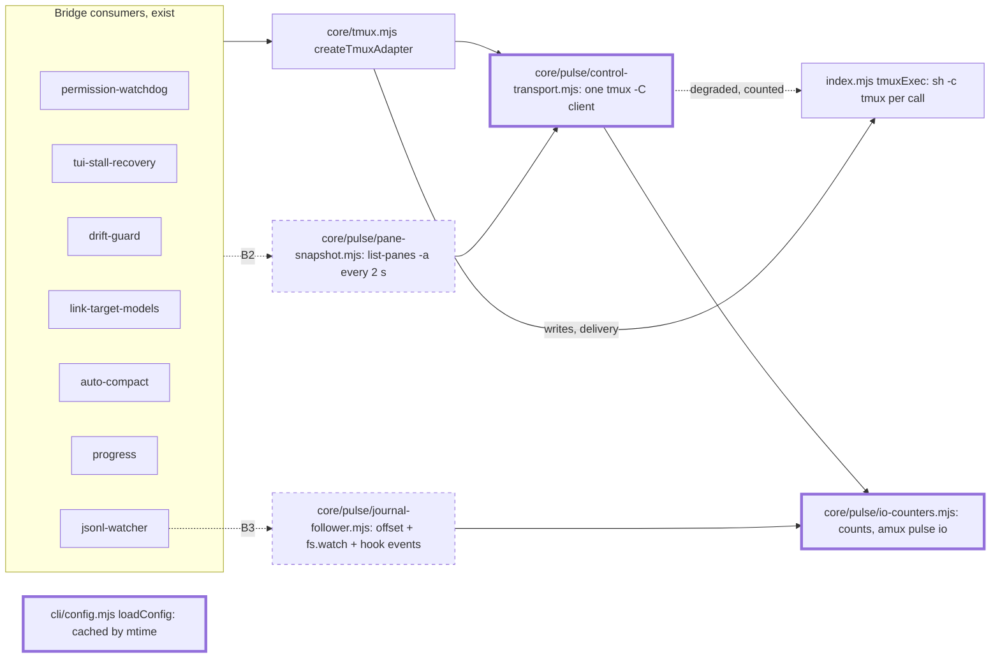
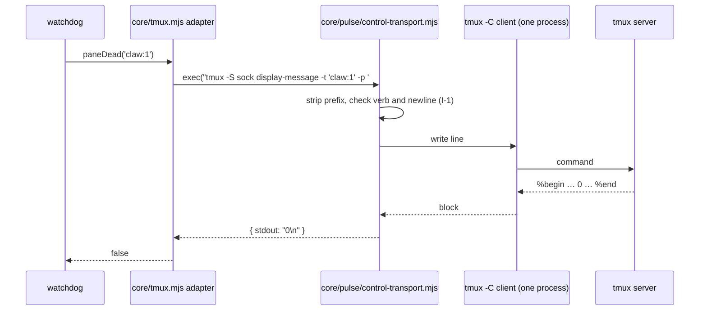
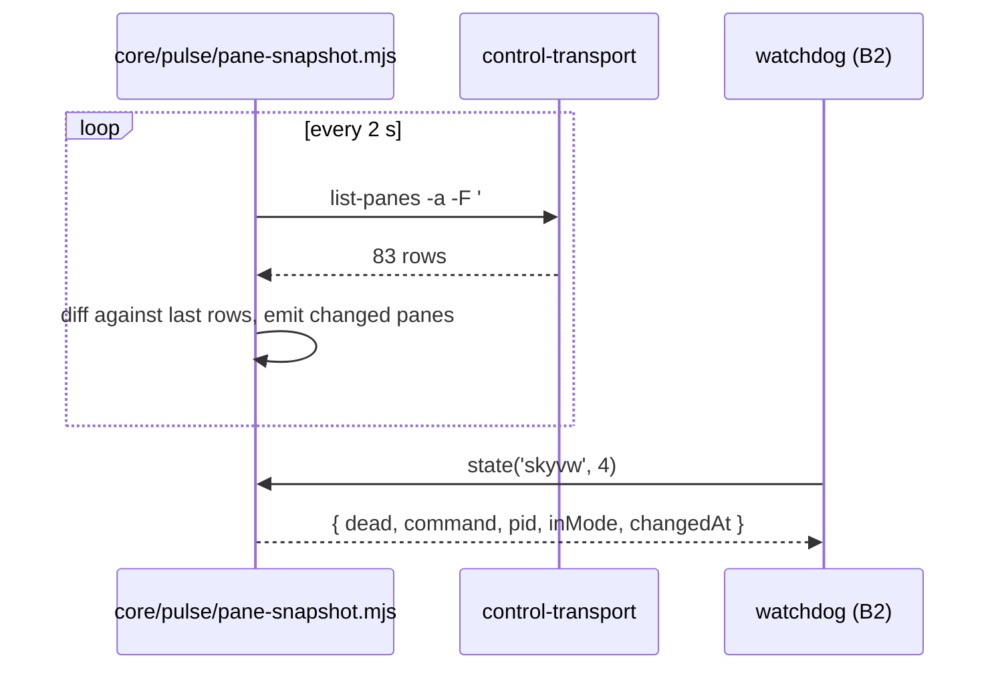
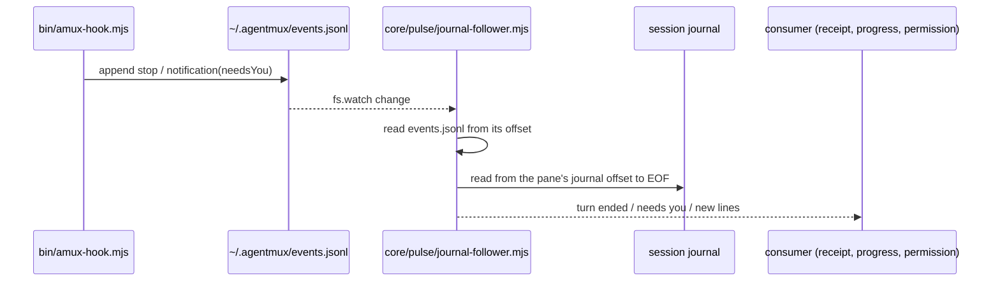
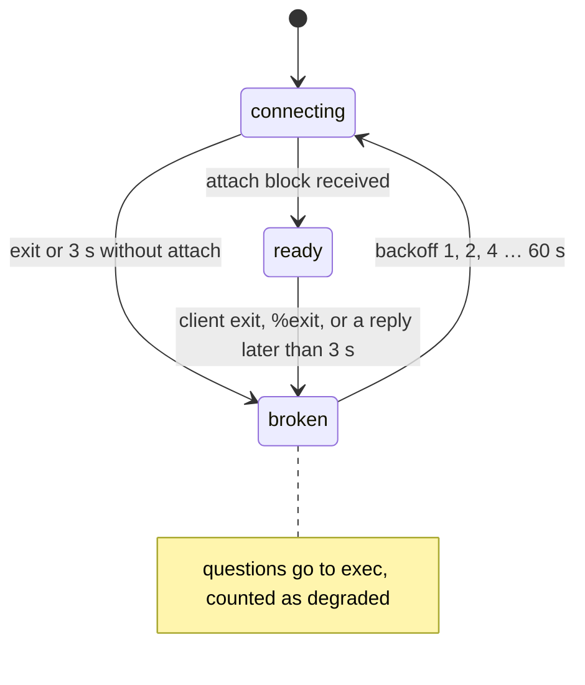

# Pulse: pane state without a process per question

Version: 2 · 2026-10-28 08:22Z · owner of the design: sandman:0 · page: none
Id: pulse

## 1. Goal

The bridge must know each pane's state without starting a process or reading a file for a pane that has not changed. It must also show what it reads, writes and starts. Mattias asked for this in sandman:0's channel on 2026-10-28, between 05:0xZ and 07:54Z (row 116 sources, plus delivery:ae88ac47f79456a25ba8318986a47d76 and delivery:c22f5da8330d0a5ebf24328e889e8831; `amux asks --list --since 12h`). The requirements:
- idle sessions should cost nothing;
- the bridge should read only the bytes that are new;
- the work should be a separate module that can be tested and switched in after it meets its criteria;
- it should show its reads and writes and count its own work;
- the result should be better long-term;
- it should come with clear tests.

Measured 2026-10-28 07:58:39–07:59:09Z, bridge 1.25.393, pid 3556, 30 s CPU profile from `~/.agentmux/profiles/`:
- The main thread was busy 49 % of the window.
- `core/tmux.mjs` `raw` took 21.5 % of the window (inclusive): every tmux question starts `sh -c tmux …` through `index.mjs` `tmuxExec`.
- Process starts alone (`spawn`, self) took 17.5 %.
- The callers in the window:

  | Caller | Share | Through |
  |---|---|---|
  | `core/tui-stall-recovery.mjs` `paneProcessState` | 10.6 % | `display` |
  | `agent.mjs` `capturePane` | 10.7 % | permission watchdog 6.2 % |
  | `isPaneDead` | 5.4 % | |
  | `currentCommand` | 5.2 % | |
  | `channels/drift-guard.mjs` | 4.6 % | |
  | `channels/link-target-models.mjs` | 6.6 % | |

- `cli/config.mjs` `loadConfig` re-read and re-parsed agentmux.yaml for every routed call: 3.8 %.

Principles, in the order they decide trade-offs:
1. An idle pane costs zero process starts, zero tmux questions of its own and zero file reads.
2. One persistent connection to tmux answers questions. A question never starts a process.
3. Every read, write, tmux command and process start is counted per consumer and per pane, and shown by `amux pulse io`.
4. A consumer switches only after a shadow period in which Pulse and today's path gave the same answers.
5. Small steps. Each is released and measured on its own, and each has its own flag to switch it off.

Non-goals:
- Delivery keeps `send-keys`, `paste-buffer` and `load-buffer` on today's exec path. Writes are not moved in this design.
- Native-runtime panes are already answered by HTTP (`core/native-runtime-client.mjs`), so they are not covered.
- Codex `notify` hooks come later. The Codex journal follower covers Codex now.

## 2. UX

n/a for screens: nothing visible in a product changes. The only new surface is a CLI command, used by agents and by Mattias in a terminal.

| Place | Product text | Max length | Stage |
|---|---|---|---|
| `amux pulse io` header | `pulse io · since <time> · transport <exec\|shadow\|control>` | 80 | B1 |
| `amux pulse io` row | `<consumer> <pane> reads <n> (<bytes>) tmux <n> starts <n>` | 100 | B1 |
| bridge log | `[pulse] control client <state> (<reason>)` | 100 | B1 |
| bridge log | `[pulse] shadow disagreement <verb> <target>: exec=<…> control=<…>` | 200 | B1 |

- **Components (atomic design):**
  - Atoms: none (no UI). The CLI rows reuse the text-table formatting of `amux ps` (reused).
  - Molecules: none.
  - Organisms: none.

## 3. Use cases

- **UC-1 Idle pane.**
  - Actor: the bridge's watchdogs. Trigger: their timers.
  - Example: skyvw:4 has been idle for 10 min; 83 panes in 8 sessions; 7 watchdogs with 3–60 s periods.
  - Result: no process starts and no file reads for skyvw:4. Its state comes from the shared pane snapshot.
  - Cost today: 60 permission-watchdog captures per pane per 10 min, plus the stall, dead and drift checks. After: 0 for this pane, plus its share of one `list-panes -a` over the connection every 2 s.
  - Stage: B2. Sequence: §5 seq-snapshot.
- **UC-2 A working pane's turn ends.**
  - Actor: Claude's Stop hook. Example: lsrc:3 ends a turn; `bin/amux-hook.mjs` appends a stop event.
  - Result: the delivery receipt and the progress line see the end within 1 s.
  - Reads: only the journal bytes appended since the saved offset.
  - Stage: B3. Sequence: §5 seq-journal.
- **UC-3 A permission prompt appears.**
  - Actor: Claude's Notification hook, with `needsYou`.
  - Result: the watchdog captures that one pane once. It does not capture all 83 panes every 10 s.
  - Stage: B4. Sequence: §5 seq-journal.
- **UC-4 A watchdog asks one tmux question.**
  - Example: `display-message -t 'claw:1' -p '#{pane_dead}'`.
  - Result: the same answer, from the control connection, with 0 process starts.
  - Cost: about 0.1 ms of parsing instead of a fork of a 1.5 GB process.
  - Stage: B1. Sequence: §5 seq-query.
- **UC-5 The tmux server restarts, or the control client dies.**
  - Result: pending questions fail within the same 3 s limit as today. Pulse logs the broken connection and answers through exec, counted as degraded, until it reconnects with backoff.
  - Stage: B1. no sequence: it is the state diagram §5 state-control.
- **UC-6 Mattias or an agent inspects the cost.**
  - Trigger: `amux pulse io`.
  - Result: reads, bytes, tmux commands and process starts per consumer and pane since the bridge started, plus the transport state.
  - Stage: B1. no sequence: a local read of the bridge's counter file.
- Unhappy cases:
  - a command with a newline (refused: it goes over exec, counted);
  - a huge capture (same 1 MB buffer limit as exec);
  - two bridges during a restart (each has its own client; both are counted);
  - inotify watch limit reached (the follower polls that file every 15 s and logs it);
  - a journal truncated or replaced (inode or size drop resets the offset to 0 and logs it).

  Not applicable, with the reason: reload, another device, phone and quota. There is no UI and no paid call.

Requirements, one testable line each:

- **pulse-1** A read-only tmux question (display-message -p, capture-pane -p, list-panes, list-sessions, list-windows, has-session) starts no process when the transport is control. Source: delivery:ae88ac47f79456a25ba8318986a47d76; own
- **pulse-2** A tmux question returns the same stdout, or the same rejection, over control as over exec. Source: own
- **pulse-3** A reply over 3 s fails only its own question, as exec's timeout does, and its late reply is dropped without shifting later answers. A client with no reply for 15 s is broken: pending questions fail, later ones start a process (counted as degraded), and it reconnects with backoff. Source: own (shadow 2026-10-28 08:35–08:37Z: a slow tmux server broke the client four times under the first rule)
- **pulse-4** In shadow mode, each sampled read-only question runs on both paths, and every difference is logged with both answers. Source: row 116 criteria; own
- **pulse-5** `amux pulse io` shows tmux questions, process starts and shadow differences per verb and pane, and the transport state (B1); reads, bytes and per-consumer counts join in B2 and B3. Source: row 116 sources (2026-10-28 05:0xZ transparency ask); own
- **pulse-6** An idle pane costs 0 process starts, 0 tmux questions of its own and 0 file reads in 10 min, with all watchdogs on. Source: row 116 criteria
- **pulse-7** A journal is read only from its saved offset. An idle journal costs 0 reads, and a truncated or replaced journal is reread from 0 with a log line. Source: row 116 criteria
- **pulse-8** agentmux.yaml is parsed again only when its mtime or size changes. Source: own (profile 2026-10-28 07:59Z, 3.8 %)
- **pulse-9** Link's target models cost one pane listing per cycle; a pane whose process, journal and model config did not change is not inspected again within 5 min. Source: own (askers 2026-10-28 10:36-10:46Z: Link 669 of 1,594 tmux questions a minute)

## 4. Architecture



Legend: thin = exists, thick = new in B0/B1, dashed = later steps B2–B4.

- **Identity:** a pane is its tmux pane id (`%N`), mapped to `agent:pane` by the snapshot. A journal is its path plus inode.
- **Ownership:**
  - The control connection, its queue and its state are written only by `control-transport.mjs`.
  - The pane snapshot is written only by `pane-snapshot.mjs`.
  - Offsets are written only by `journal-follower.mjs`.
  - Counters are written only by `io-counters.mjs`.
- **One exit:** every tmux process start goes through `index.mjs` `tmuxExec`. The transport calls it for writes and in degraded mode, so `amux pulse io` sees all starts.
- **Switches:**
  - `AMUX_PULSE_TRANSPORT=exec|shadow|control` decides which path answers read-only questions. The default is shadow in B1's release and control after a clean shadow period.
  - Later flags decide per consumer whether it reads the snapshot or the follower.
- **Maintainability** (`~/.claude/coding-philosophy.md` §3):
  1. Owner: the adapter in `core/tmux.mjs` stays the only place that builds tmux commands. Pulse swaps its `exec`, so no caller copies tmux logic.
  2. Variation: the transport is one small adapter with the same `(cmd) => {stdout}` shape as exec. Verbs allowed over control are data, a set of read-only verbs.
  3. Inputs, outputs, errors and side effects are explicit:
     - rejection has exec's shape (`code`, `stderr`);
     - the transport depends on no screen and no engine.
  4. All adapter callers stay valid. The contract test runs the same questions through both transports against a private tmux server.
  5. Trade-off: a stateful connection is harder to reason about than a fork, so the state machine is explicit and has its own tests. Performance wins because forks of a 1.5 GB process dominate the profile.
- **Invariants:**
  - **I-1** A question with a newline, or with a verb outside the read-only set, never goes over the control connection. Enforced in `control-transport.mjs`; guarded by `core/pulse/control-transport.test.mjs::routes writes and multi-line commands to exec`.
  - **I-2** Each command line gets exactly one reply block, matched in order. Enforced in `control-transport.mjs`; guarded by `core/pulse/control-transport.test.mjs::matches replies in order under a burst of 200 questions`.
  - **I-3** Pulse never starts or restores tmux sessions on a server. Tests use `tmux -f /dev/null` on a private socket, because the user's tmux-continuum restores the whole fleet into any new server. Measured 2026-10-28 08:03Z. Guarded by the test helper's `-f /dev/null` and a test asserting the private server holds only its own sessions.

## 5. Behaviour (UML)









## 6. Pseudocode

```
controlExec(cmd):                                  # core/pulse/control-transport.mjs, replaces exec for the adapter
  args = stripTmuxPrefix(cmd, socket)              # "tmux -S '<socket>' " exactly, else -> exec
  if args has "\n" or verbOf(args) not in READ_ONLY: count(start, degraded=false); return tmuxExec(cmd)   # I-1
  if state != ready: count(start, degraded=true); warnOnce(state); return tmuxExec(cmd)
  if mode == shadow and sampled(): return compareBoth(cmd, args)
  job = { args, resolve, reject, timer: 3000 ms }  # same limit as tmuxExec
  queue.push(job); client.stdin.write(args + "\n"); count(tmuxCommand)
  return job.promise

onBlock(lines, ok):                                # a %begin … %end or %error block
  job = queue.shift(); assert job                  # I-2: one block per command, in order
  if ok: job.resolve({ stdout: lines.length ? lines.join("\n") + "\n" : "", stderr: "" })
  else:  job.reject(Object.assign(new Error(lines.join("\n")), { code: 1, stderr: lines.join("\n") + "\n" }))

onTimeout(job): markBroken("reply over 3 s"); rejectAll(queue); restart client with backoff   # pulse-3

loadConfig(path):                                  # cli/config.mjs, pulse-8
  st = statSync(path)
  if cache.path == path and cache.mtimeMs == st.mtimeMs and cache.size == st.size: return clone(cache.value)
  value = yaml.load(read(path)); cache = { path, mtimeMs, size, value }; return clone(value)
```

Fields read and where they are stored:
- the socket: `index.mjs:102` `TMUX_SOCKET`;
- the command string: built by `core/tmux.mjs:38` `raw`;
- the 3 s limit: `index.mjs:137` `tmuxExec`;
- the config path: `core/runtime-defaults.mjs` `runtimeAgentsPath`.

Readers of the changed path (grep of `tmuxExec`, `createTmuxAdapter(` and `ctx.tmux(`), each through `exec` and therefore unchanged:
- `agent.mjs:214`;
- `core/claude-quota-lifecycle.mjs:77`;
- `channels/idle-capacity-runtime.mjs:71`;
- `channels/foreign-draft-runtime.mjs:30`;
- `index.mjs:332` `ctx.tmux`.

Each branch is proved by the tests in §12. Shadow and degraded counts are proved by `core/pulse/control-transport.test.mjs`.

## 7. Platform limits

- tmux 3.2a control mode, measured on a private server 2026-10-28 08:03Z (probe `cm-probe.mjs`, `-f /dev/null`):
  - one `%begin <time> <n> <flags>` … `%end`/`%error` block per command line;
  - an error is `%error` with tmux's message, such as `can't find session: nope`;
  - shell-style quoting `'a'\''b'` arrives as `a'b`.
- tmux 3.2a format subscriptions (`refresh-client -B`) report only the attached session's panes, not `%*` across sessions. Measured on the same probe. So the snapshot uses one `list-panes -a` over the connection instead of 8 clients.
- Control client flags `no-output,ignore-size`, measured. Combined with the fleet's `window-size manual` (`~/.tmux.conf:110`), the client changes no window size. The client-attached hooks were removed with row 52 (`~/.tmux.conf:113`).
- tmux-continuum `@continuum-restore 'on'` restores the saved fleet into any new tmux server that loads `~/.tmux.conf`. Measured 2026-10-28 08:02:56Z. Tests must start private servers with `-f /dev/null`.
- Exec today: 3 s timeout, 1 MB stdout buffer (`index.mjs:137`, Node default `maxBuffer` for exec). Control mode keeps the same 3 s and refuses a reply over 1 MB.
- inotify: `fs.inotify.max_user_watches`, assumed above 83 journals plus events.jsonl; B3's follower test reads the real value at start.

## 8. Alternatives

- **A Keep exec, poll less often.**
  - Cost: same forks per question, fewer questions.
  - Build time: minutes.
  - Not chosen: slower state and still a process per question. The 30-minute push timer showed that a slower poll is a stopgap.
  - Reopen if control mode proves unstable in shadow.
- **B One control-mode client plus a shared snapshot** (chosen).
  - Cost: one long-lived process, no fork per question.
  - Build time: B0 1 h, B1 5 h, B2 4 h, B3 6 h, B4 2 h (estimates).
  - Chosen: it removes the measured top cost behind the existing adapter seam without touching consumers first.
- **C One control client per session with subscriptions.**
  - Cost: 8 long-lived clients. tmux checks formats once per second.
  - Not chosen now: more moving parts, and the snapshot over one client covers all sessions.
  - Reopen if the 2 s `list-panes -a` shows up above 2 % in a profile.
- **D A tmux library or binding in Node.** Not chosen: no maintained binding beyond spawning tmux. Control mode is tmux's own interface for this.

| Check in the user's path | Failure it catches | Wait per use | How others do it (link) |
|---|---|---|---|
| Shadow comparison of sampled questions (B1, temporary) | control answers differing from exec | one extra exec per sampled question, 1 in 20 | iTerm2's tmux integration keeps one control-mode client: https://iterm2.com/documentation-tmux-integration.html ; tmux control mode docs: https://github.com/tmux/tmux/wiki/Control-Mode |

## 9. Risks

- **R-1 A hung control client stalls every watchdog.**
  - Likelihood low, cost high: watchdogs stop seeing panes.
  - Mitigation: per-question 3 s timer, then the broken state with exec for later questions.
  - Detection: `control-transport.test.mjs::fails pending questions and degrades to exec when the client stops replying`, plus the `[pulse] control client broken` log line and the degraded counter in `amux pulse io`.
  - Fallback: `AMUX_PULSE_TRANSPORT=exec`. Owner: sandman:0.
- **R-2 A parsing difference changes an answer**, for example a trailing newline or a `%`-prefixed line inside a capture.
  - Likelihood medium, cost medium.
  - Mitigation: replies end only at `%end`/`%error` lines carrying the same command number. Capture lines that start with `%` cannot match that.
  - Detection: shadow mode logs every difference; contract test `answers the same as exec`.
  - Fallback: exec. Owner: sandman:0.
- **R-3 Quoting differs from sh for some argument.**
  - Likelihood low, cost medium.
  - Mitigation: only the adapter builds commands, with `esc()`.
  - Detection: contract test with `'`, `"`, `$`, `#{}`, spaces and unicode.
  - Fallback: that verb goes over exec. Owner: sandman:0.
- **R-4 A test starts the fleet in a private tmux server.**
  - Likelihood was high: it happened 08:02:56Z.
  - Mitigation: the test helper always passes `-f /dev/null`.
  - Detection: a test asserts the private server holds only its own sessions.
  - Fallback: kill the private server. Owner: sandman:0.
- **R-5 The client attaches to a session that is later killed.**
  - Likelihood medium, cost low.
  - Mitigation: on `%exit` or `%session-changed` to nothing, reconnect to any existing session.
  - Detection: test `reconnects after its session is killed`.
  - Fallback: exec. Owner: sandman:0.
- **R-6 Two bridges during a restart each run a client.**
  - Likelihood medium, cost low.
  - Mitigation: each client lives and dies with its bridge process (the stdin pipe closes).
  - Detection: `amux doctor` lists tmux clients with the `C` control flag.
  - Fallback: none needed. Owner: sandman:0.

## 10. Cost and time

- Cost per 30 s of bridge time: today 14.6 s busy, 17.5 % in process starts (measured, profile 07:59Z). After B1: process starts for read-only questions 0. Busy time is estimated at 7–9 s, from removing `raw`/`spawn` and keeping parsing.
- After B2 and B3: an idle pane costs 0 (estimated). The bridge is under 10 % busy with the whole fleet (target, measured in the live check).
- Time per part, at the 2026-10-19 pace of about 15 min per 100 lines for well-specified changes in known files, plus tests:

  | Step | Files | Estimate |
  |---|---|---|
  | B0 | `cli/config.mjs` (+15 lines), test | 1 h |
  | B1 | `core/pulse/control-transport.mjs` (about 220 lines new), `core/pulse/io-counters.mjs` (about 80), `index.mjs` (+15), `cli/pulse.mjs` (about 60), tests about 200 | 5 h |
  | B2 | `core/pulse/pane-snapshot.mjs` (about 120), consumers `channels/permission-watchdog.mjs`, `core/tui-stall-recovery.mjs`, `channels/drift-guard.mjs`, `channels/link-target-models.mjs` (+10–30 each) | 4 h |
  | B3 | `core/pulse/journal-follower.mjs` (about 200), `channels/jsonl-watcher.mjs`, `core/progress.mjs` | 6 h |
  | B4 | `channels/permission-watchdog.mjs` captures on needsYou | 2 h |

  Wall time is dominated by the shadow periods after B1 and B2.
- Agent quota: built on this pane's Claude account. Read `amux quota` before B2.

## 11. Rollout and rollback

- **B0** ships alone. Switching it off means reverting its commit. There is no data.
- **B1** shipped with `AMUX_PULSE_TRANSPORT` defaulting to `shadow` (1.25.395). The default became `control` in 1.25.397, after 93 min of shadow in which control answered no question wrongly (v4). Rollback: `AMUX_PULSE_TRANSPORT=exec` in `~/.agentmux/.env` and `amux restart`.
- **B2–B4** each get a per-consumer flag. They keep the same shadow-then-switch order.
- Switching off never breaks data. Pulse writes only its counter file (`~/.agentmux/pulse-io.json`, rewritten at most every 10 s, under 64 KB) and, in B3, its offset file (under 64 KB). Deleting either resets the counts or offsets.
- Migrations: none. Texts: `amux pulse --help`. The fleet docs line for `amux pulse io` goes in `docs/fleet/maintenance.md` in B1's release.

## 12. Tests

| Changed path | Tests that run |
|---|---|
| `cli/config.mjs` | `cli/config.test.mjs::parses agentmux.yaml again only when it changes` |
| `core/pulse/control-transport.mjs` | `core/pulse/control-transport.test.mjs::logs a shadow disagreement with both answers`, `core/pulse/control-transport.test.mjs::answers the same as exec`, `core/pulse/control-transport.test.mjs::starts no process for read-only questions`, `core/pulse/control-transport.test.mjs::routes writes and multi-line commands to exec`, `core/pulse/control-transport.test.mjs::matches replies in order under a burst of 200 questions`, `core/pulse/control-transport.test.mjs::a slow reply fails only its own question and keeps the client`, `core/pulse/control-transport.test.mjs::fails pending questions and degrades to exec when the client stops replying`, `core/pulse/control-transport.test.mjs::reconnects after its session is killed`, `core/pulse/control-transport.test.mjs::never starts a tmux server` |
| `core/pulse/io-counters.mjs` | `core/pulse/control-transport.test.mjs::starts no process for read-only questions`, `cli/pulse.test.mjs::shows counts per verb and pane`, `cli/pulse.test.mjs::names who asked each question` |
| `index.mjs` | `core/pulse/control-transport.test.mjs::answers the same as exec`, `core/tmux.test.mjs` |
| `cli/pulse.mjs` | `cli/pulse.test.mjs::shows counts per verb and pane` |
| `docs/fleet/maintenance.md` | n/a: documentation |
| `channels/permission-watchdog.mjs` | n/a: changes in B2 and B4; their tests are added to this table in that step's design delta |
| `core/tui-stall-recovery.mjs` | n/a: changes in B2; tests added with B2 |
| `channels/drift-guard.mjs` | n/a: changes in B2; tests added with B2 |
| `channels/link-target-models.mjs` | `channels/link-target-models.test.mjs::an unchanged pane is not inspected again`, `channels/link-target-models.test.mjs` |
| `core/tmux.mjs` | `core/tmux.test.mjs::listAllPanes reads every session's active-window panes in one question`, `core/tmux.test.mjs` |
| `core/pulse/pane-snapshot.mjs` | n/a: new in B2; tests added with B2 |
| `core/pulse/journal-follower.mjs` | n/a: new in B3; tests added with B3 (pulse-7) |
| `channels/jsonl-watcher.mjs` | n/a: changes in B3; tests added with B3 |
| `core/progress.mjs` | n/a: changes in B3; tests added with B3 |

| Test | Guards | Level | Write min | Run s |
|---|---|---|---|---|
| `cli/config.test.mjs::parses agentmux.yaml again only when it changes` | pulse-8 | unit | 10 | 1 |
| `core/pulse/control-transport.test.mjs::answers the same as exec` | pulse-2, R-2, R-3 | integration | 30 | 5 |
| `core/pulse/control-transport.test.mjs::starts no process for read-only questions` | pulse-1, pulse-5 | integration | 15 | 3 |
| `core/pulse/control-transport.test.mjs::routes writes and multi-line commands to exec` | I-1 | component | 10 | 1 |
| `core/pulse/control-transport.test.mjs::matches replies in order under a burst of 200 questions` | I-2 | integration | 10 | 3 |
| `core/pulse/control-transport.test.mjs::a slow reply fails only its own question and keeps the client` | pulse-3, R-1, defect: 4 reconnects in shadow 08:35–08:37Z | component | 15 | 3 |
| `core/pulse/control-transport.test.mjs::fails pending questions and degrades to exec when the client stops replying` | pulse-3, R-1 | component | 20 | 4 |
| `core/pulse/control-transport.test.mjs::reconnects after its session is killed` | R-5, I-3 | integration | 15 | 5 |
| `cli/pulse.test.mjs::shows counts per verb and pane` | pulse-5 | unit | 10 | 1 |
| `cli/pulse.test.mjs::names who asked each question` | pulse-5 | unit | 10 | 1 |
| `core/pulse/control-transport.test.mjs::never starts a tmux server` | I-3, R-4 | integration | 10 | 2 |
| `core/pulse/control-transport.test.mjs::logs a shadow disagreement with both answers` | pulse-4 | component | 10 | 1 |
| `core/tmux.test.mjs` | existing | unit | 0 | 2 |
| `core/tmux.test.mjs::listAllPanes reads every session's active-window panes in one question` | pulse-9 | unit | 10 | 1 |
| `channels/link-target-models.test.mjs::an unchanged pane is not inspected again` | pulse-9 | component | 15 | 1 |
| `channels/link-target-models.test.mjs` | existing | component | 0 | 1 |

- Budget: 130 min of tests within B0+B1's 6 h. Targeted run with smoke about 36 s.
- Manual evidence for pulse-6 and the live check:
  - a bridge CPU profile of 30 s before and after each step;
  - `amux pulse io` after 10 min, showing 0 starts for idle panes (B2);
  - delivery median from events.jsonl over 1 h.
- Full proof: none: no money, privacy, sign-in, access, deletion, migration or user data is touched.
- Touched tests: none: B1 swaps only the adapter's exec. `core/tmux.test.mjs` is kept unchanged and must stay green. B2's consumers keep their tests and gain a snapshot fixture in B2.
- Hardest case: the control client answers the adapter's own command strings exactly like exec, on tmux 3.2a, with quotes and errors.
  - Probed 2026-10-28 08:03Z on a private server: framing, quoting, `%error`.
  - Receipt: the probe output in this session. The contract test makes it permanent.
- Rehearsal step: n/a. agentmux has no rehearsal runner. The live check is the bridge profile and `amux pulse io` after release.
- Fixtures: a private tmux server (`-f /dev/null`, short socket under `/tmp/claude-1000`). Its panes hold `'`, `"`, `$`, `#{}`, unicode and 200-line captures.
- Browsers and devices: n/a. Live categories touched: none of money, user data, access, deletion, upload or playback.
- Small first:
  - [x] Pieces: each test uses a private tmux server with 2 sessions and 3 panes, at most 200 lines.
  - [x] Edge cases: quotes, `$`, `#{}`, unicode, a `%`-prefixed line inside a capture, an error reply, a killed session and a hung client (SIGSTOP).
  - [x] Seams: the adapter's real `raw` strings against real tmux 3.2a, through both transports. The probe ran 08:03Z.
  - [ ] Whole path: n/a: no rehearsal runner. The shadow period on the live bridge is the whole path, read through its difference log.
  - [ ] Big input last: n/a: the fleet is the only large input. It runs in shadow first, which cannot change answers.

## 13. Tasks

| # | Prio | Task | Owner | State | Estimate | Spec | Done when |
|---|---|---|---|---|---|---|---|
| 116a | P1 | B0 agentmux.yaml parsed only when it changes | sandman:0 | working | 1h | [Pulse §12](DESIGN-pulse.md#12-tests) | the config test is red before and green after, released, and loadConfig is gone from a 30 s bridge profile |
| 116b | P1 | B1 control-mode transport for read-only tmux questions, shadow then control, plus `amux pulse io` | sandman:0 | open | 5h | [Pulse §6](DESIGN-pulse.md#6-pseudocode) | 0 process starts for read-only questions in `amux pulse io`, shadow with no question control answered wrongly, bridge busy below 30 % |
| 116c | P1 | B2 shared pane snapshot read by the four watchdogs | sandman:0 | open | 4h | [Pulse §5](DESIGN-pulse.md#5-behaviour-uml) | an idle pane shows 0 tmux questions and 0 starts in 10 min in `amux pulse io` |
| 116d | P1 | B3 journal follower by offset, woken by fs.watch and hook events | sandman:0 | open | 6h | [Pulse §5](DESIGN-pulse.md#5-behaviour-uml) | an idle journal costs 0 reads in 10 min, and turn ends are seen within 1 s |
| 116e | P2 | B4 permission watchdog captures only on a needsYou event | sandman:0 | open | 2h | [Pulse §3](DESIGN-pulse.md#3-use-cases) | 0 periodic captures, and a recorded permission prompt is still answered |

## 14. Open questions

None. Every choice above is within the owner's frame: no money, no external party, nothing irreversible.

## 15. Changes

- v6 2026-10-28 11:05Z: B2a. Link's target models were 669 of 1,594 tmux questions a minute (10:36-10:46Z): two display-messages and a 100-line capture per target every 15 s, plus inspectPane's journal reads. They now read one `list-panes -a` per cycle and inspect a pane again only when its pid, command, dead flag, journal stamp or model config changed, or after 5 min, because a Codex in-session model switch writes no journal Link reads (pulse-9). Owners told: none.
- v5 2026-10-28 10:40Z: B2 starts by counting who asks. Profiles at 10:19Z (busy 24 %, load 8) and 10:27Z (busy 77 %, load 44) show the cost spread over many watchers (codex-credit-stop, sleep probes, isBusy, inspectPane, drift-guard, jsonl-watcher), not the four named in v1, and every pane gets 25-45 tmux questions a minute, idle or not. Each question now carries its asker (up to three agentmux functions above the adapter, 27 us), and `amux pulse io` lists questions per minute by asker. B2's snapshot is chosen from that list. Owners told: none.
- v4 2026-10-28 10:17Z: B1's default becomes `control` after 93 min of shadow instead of 24 h. 6,185 checks under the day's heaviest load (v1d-stats pushes at 4-7 CPU-min, load up to 35): no control timeout, no late reply, no reconnect. Of 20 differences, 7 were the screen changing between the two reads. In 13, exec returned an empty successful answer where control returned the pane's text, in two clusters (09:12-09:15Z, 09:57Z); not reproduced on a private server, quiet or busy (0 of 14,000). 24 h more shadow would cost about 1.9 M tmux process starts (22 per second). Owners told: none.
- v3 2026-10-28 08:43Z: in shadow, a slow tmux server (exec answers up to about 2 s) made single replies exceed 3 s, and the first rule broke the client four times between 08:35 and 08:37Z, failing every pending question. Now a timeout fails only its own question, like exec, and the client is broken only after 15 s with no reply. A reply already in the pipe after an event-loop stall is read before the timeout counts. Shadow records the kind of each difference and the first differing line. Owners told: none.
- v2 2026-10-28 08:22Z: B1 as built. The client attaches to its own session `amux-pulse` with `tmux -N` (never starts a server), because `amux sleep` and the window-size pin read agent sessions' attached clients. A hung client is simulated by freezing the tmux server, since the server writes replies straight to the client's stdout. `amux pulse io` counts per verb and pane in B1; per consumer in B2. Owners told: none.
- v1 2026-10-28 08:07Z: first version. Measured profile, control-mode probe and the continuum hazard. Owners told: none; sandman:0 builds every step.
