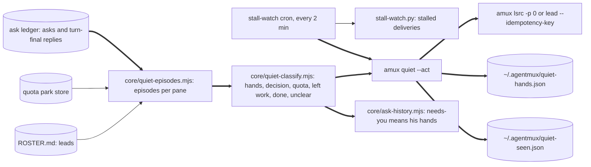
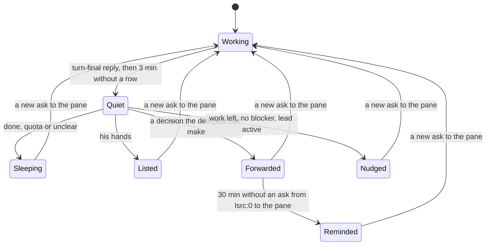

# amux quiet: why a pane went quiet, and the one obvious action

Version: 3 · 2026-10-20 11:40Z · owner of the design: api:0 · page: none yet
<!-- stale: -->

## 1. Goal

His request and yes for this tool are in `~/.agentmux/PRIORITIES.md`, "Tillägg 2026-10-20 ~10:1xZ: uppföljning av
stannade agenter". He asked for something in amux that follows up on a stopped agent: check that the stop was fine or
that it waits for tokens, start it again when that is obvious, and otherwise let it sleep, without chaos. lsrc:0's order
to api:0 the same morning gives the classes, the anti-chaos rules and the proof. The case that started it: claw:0
ended three turns (09:19, 09:26 and 09:30Z) with "Väntar på dig", a yes or no on row 156 at most 0.35 USD. Under his
08:34Z mandate the delegate decides that, but nobody saw it until he asked. `amux asks --open` shows 103 needs-you
across 7 projects today, mostly noise; lsrc:0 counted about 70 in its view.

lsrc:0's input at 11:2xZ: at 11:15Z idle-capacity notices said claw:1, lsrc:1 and lsrc:2 could not work for 21 to
52 minutes while `amux ps` showed all three working (claw:1 thinking for 2m51s). After the 11:10Z window reset the
notices fired on stale park and limit state. At 11:16Z the notices for skyvw:1 and skyvw:2 reported recovery receipts
from 19 Oct (18:24Z and 13:25Z) while skyvw:1 was posting: `resumeStatus` takes the newest recovery job of any episode.

The outcome:

1. When a pane ends a turn and stays quiet, amux classifies why, once per episode, and acts only when it is obvious:
   - **his hands** (a login, a payment card, a key, hardware, his own test): no message; one line in a short list
     that lsrc:0 shows him;
   - **a decision the delegate can make** (a yes or no: "ditt ja", "ja eller nej", "Beslut för Mattias", without his
     hands, on a line that asks rather than reports): forwarded to lsrc:0 at once, one per pane until lsrc:0 answers it,
     and one reminder if lsrc:0 has not answered the pane in 30 minutes;
   - **quota**: the existing park and resume; nothing new;
   - **work left and no named blocker, quiet for 20 minutes**: one nudge to its lead;
   - **done, an empty queue or no clear reason**: it sleeps.
2. `needs-you` in `amux asks` and `amux done` means his hands only, so 103 shrinks to the real few.
3. No notice, from quiet or from the idle-capacity alarm, about a pane that is working or thinking; an idle-capacity
   episode closes when its recovery prompt is acknowledged.

Principles, in the order they decide:

1. Act only when obvious. An unclear reply sleeps; a wrong nudge costs more than a late one.
2. One notice per pane per episode. A pane that repeats the same waiting line is one episode.
3. Never wake a dormant pane, and never resend a delivery whose outcome is unknown.
4. Reuse: the stall-watch cron, the ask ledger, `amux <agent> -p N --idempotency-key`, the quota park store.
5. His words stay his: the forward quotes the pane's line, never his.

Non-goals: no new daemon or timer, no model call to classify, no change to quota park and resume, no automatic yes on
any decision.

## 2. UX

n/a: a command-line tool and messages between panes; no screens. New strings:

| Place | Product text | Max length | Stage |
|---|---|---|---|
| Forward to lsrc:0 | `[quiet] claw:0 waits for a decision you can make (09:19Z): "Väntar på dig. Ja eller nej … rad 156, högst cirka 0,35 USD." Reply to claw:0.` | 400 | v1 |
| Reminder to lsrc:0 | `[quiet] reminder: claw:0 still waits for your decision since 09:19Z (forwarded 09:22Z).` | 140 | v1 |
| Nudge to a lead | `[quiet] claw:3 stopped at 09:40Z with work left and no blocker: "LEFT: …". Restart it or hand the work on.` | 300 | v1 |
| `amux quiet --hands` | `skyvw:0 · since 08:12Z · login: "Logga in på Google Play Console i din webbläsare."` one line per pane | 160 per line | v1 |
| `amux quiet --replay` summary | `06:00–10:00Z · 41 episodes · hands 2 · decision 3 · quota 4 · left work 6 · done 19 · unclear 7` | 120 | v1 |
| `amux asks` status | `🔴 needs-you` only for his hands; a forwarded decision shows `↪ delegate` | 20 | v1 |

## 3. Use cases

- **UC-1 A decision the delegate can make.** claw:0 ends a turn at 09:19:34Z with "Väntar på dig. Ja eller nej …
  rad 156, högst cirka 0,35 USD." and gets no new ask.
  - At the first cron run 3 minutes later (09:22–09:24Z), `amux quiet --act` classifies it as a decision and queues
    one forward to lsrc:0 with idempotency key `quiet:claw:0:<episode>`. The same line in the 09:26 and 09:30Z replies
    is the same episode: no second forward.
  - If lsrc:0 has sent nothing to claw:0 by 09:52Z, one reminder. Cost: two queued messages, no money. Stage v1.
    Sequence: §5 seq-quiet.
- **UC-2 His hands.** skyvw:0 ends with "Logga in på Play Console i din webbläsare, sedan kör jag vidare." The pane
  gets a line in `~/.agentmux/quiet-hands.json`; `amux quiet --hands` prints it for lsrc:0. No message to anyone.
  Stage v1. Sequence: §5 seq-quiet.
- **UC-3 Quota.** A pane stops at its session limit. The quota park store already holds it; quiet does nothing.
  Stage v1. No sequence: no action.
- **UC-4 Work left, no blocker.** claw:3 ends with "LEFT: tåg 19:s grindar och släpp" and no BLOCKED or "väntar på".
  Its lead (claw:0 by ROSTER) gets one nudge, but only when claw:0 has had a ledger row in the last 2 hours. Stage v1.
  Sequence: §5 seq-quiet.
- **UC-5 Done.** "DONE: … OPEN: none" or an empty LEFT: it sleeps. Stage v1. No sequence: no action.
- **UC-7 Stale quota state.** At 11:15Z, five minutes after a window reset, claw:1 is thinking but its park record
  still says parked. The idle-capacity alarm reads the live status, sees it working and sends nothing; once the
  recovery prompt is acknowledged, that episode is closed for good. Stage v1. No sequence: one check inside the alarm.
- **UC-6 Replay.** `amux quiet --replay --since 2026-10-20T06:00Z --until 2026-10-20T10:00Z` prints every episode's
  class and the action it would take, sends nothing, and prints needs-you before and after. Stage v1. No sequence:
  one read-only process.
- **Unhappy cases:**
  - A pane that is still working (a new ask or row after its reply): no episode; quiet waits for a turn end.
  - Two classes in one reply ("logga in … sedan ditt ja"): his hands win; he must act anyway.
  - lsrc:0 itself goes quiet waiting for him: forwards to lsrc:0 never go to lsrc:0 about lsrc:0; its line goes to
    his-hands only if it names his hands, else it sleeps.
  - The forward's delivery outcome is unknown: the episode is marked done; nothing is resent.
  - The lead is dormant (no row in 2 hours) or is the pane itself: no nudge.
  - The cron is late or runs twice: the seen file and the idempotency key make the second run a no-op.
  - Restarted bridge or a rotated log: episodes are rebuilt from the ledger; the seen file keeps sent keys.

## 4. Architecture



- Identity: an episode is pane plus the normalized waiting line (or the reply id when there is none), from the
  pane's turn-final reply until its next ask.
- Ownership: `quiet-episodes.mjs` is the only writer of `quiet-seen.json` and `quiet-hands.json`. Sends go only
  through the existing `amux <agent> -p N --idempotency-key` path.
- One exit: every message leaves through that one send call in `cli/quiet.mjs`.
- Switches: `AMUX_QUIET=0` makes `--act` print without sending; `--replay` never sends.
- Invariants:
  - **I-1** At most one forward, one reminder and one nudge per episode. Enforced in `quiet-episodes.mjs` (seen keys),
    guarded by `core/quiet-episodes.test.mjs`, "sends one forward for three replies with the same line".
  - **I-2** No send to a dormant pane, and no resend after an unknown outcome. Enforced in `cli/quiet.mjs`, guarded by
    `cli/quiet.test.mjs`, "never nudges a dormant lead" and "marks an unknown outcome as sent".
  - **I-4** No notice about a pane whose live status is working or thinking, and none after its recovery prompt is
    acknowledged. Enforced in `cli/quiet.mjs` and `core/idle-capacity-alarm.mjs` through `isLiveStatus`
    (`core/pane-status.mjs`), guarded by `core/idle-capacity-alarm.test.mjs`, "sends no idle notice about a working
    pane" and "closes the episode when the recovery prompt is acknowledged".
  - **I-3** Only his hands make needs-you. Enforced in `core/ask-history.mjs` through `classifyQuiet`, guarded by
    `core/ask-history.test.mjs`, "needs-you only for his hands".

## 5. Behaviour (UML)

```mermaid
%% id: seq-quiet
sequenceDiagram
  participant P as claw:0 (UC-1, UC-2, UC-4)
  participant L as ask ledger
  participant CR as stall-watch cron
  participant Q as amux quiet --act
  participant LS as lsrc:0
  P->>L: turn-final reply "Väntar på dig. Ja eller nej …"
  CR->>Q: every 2 minutes
  Q->>L: replies and asks of the last 6 hours
  Q->>Q: episode quiet for 3 min; classify: decision
  Q->>LS: amux lsrc -p 0 --idempotency-key quiet:claw:0:<episode>
  Q->>Q: seen += forward key
  Note over Q,LS: 30 min later, no ask from lsrc:0 to claw:0
  Q->>LS: one reminder, key quiet:claw:0:<episode>:reminder
```



## 6. Pseudocode

```
classifyQuiet(reply, { parked }):                     # quiet-classify.mjs, pure
  if parked: return quota
  waiting = lines with "väntar på", "BLOCKED:", "ja eller nej", "ditt ja", "Beslut för", "your decision", plus the last
            600 characters
  if waiting matches HANDS (logga in, inloggning, login, betalkort, card, payment method, API-nyckel, api key,
     lösenord, 2FA, SMS-kod, hårdvara, hardware, din telefon, i din webbläsare, ditt eget test, testa själv, koppla in):
     return hands
  if a waiting line that is not a SUMMARY, GOAL, DONE or VERIFIED line matches DECISION (ditt ja, ja eller nej, ja/nej,
     ditt beslut, beslut för <operator>, needs your yes, needs your decision, your decision): return decision
     # v4: "väntar på dig" alone is no decision; in the replay it waited on another pane or reported rows waiting on him
  if LEFT: has content other than none/inget/ingenting/- and no BLOCKED:/väntar på/blocked by: return left
  if DONE: or OPEN: none or looksDone(reply): return done
  return unclear
  # tests: quiet-classify.test.mjs "the claw:0 line is a decision", "a login is his hands", "hands win over a
  #        decision", "LEFT without a blocker is left work", "DONE with OPEN none is done", "a question alone is unclear"

episodes(ledger rows of the last 6 h, now):           # quiet-episodes.mjs
  for each pane: last turn-final reply (post kind reply) with no ask or post after it
  quiet when now - reply.ts >= 3 min, or 20 min when the class is left (v4)
  key = pane + hash(normalized waiting line) or the reply id; the same line in later replies keeps the key
  # tests: "sends one forward for three replies with the same line", "a new ask ends the episode",
  #        "a pane still working has no episode"

act(episode, seen, send, now):                        # cli/quiet.mjs
  decision and not seen[key] and no forward about the pane in 30 min that lsrc:0 has not answered (v4):
     send(lsrc:0, forward, key); seen[key] = sent or unknown
  decision and seen[key] and no ask from lsrc:0 to the pane since and now - sent >= 30 min and not seen[key:reminder]:
     send(lsrc:0, reminder, key:reminder)
  left and lead active in 2 h and lead != pane and not seen[key]: send(lead, nudge, key)
  hands: quiet-hands.json[pane] = line, since; removed when a new ask reaches the pane
  never send when the pane is lsrc:0 and the target is lsrc:0; never resend a key whose outcome was unknown
  # tests: cli/quiet.test.mjs "forwards a decision once and reminds once", "never nudges a dormant lead",
  #        "marks an unknown outcome as sent", "lists his hands without a message", "replay sends nothing"

idlePaneEvidence(..., paneStatus, recovery):          # idle-capacity-alarm.mjs
  isLiveStatus(paneStatus) -> null                    # working or thinking: no episode, no notice
  recovery acknowledged -> the episode is closed and never notified again
resumeStatus(park, history, since):                   # idle-capacity-alarm.mjs
  only quota-recovery jobs created at or after the episode's since count; none -> "no resume for this stop yet"
  # test: idle-capacity-alarm.test.mjs "reports only this episode's recovery"
  # tests: idle-capacity-alarm.test.mjs "sends no idle notice about a working pane",
  #        "closes the episode when the recovery prompt is acknowledged"
act(...) also returns before any send when isLiveStatus(the pane's status) is true.

classifyAskTurn(turn):                                # ask-history.mjs
  needs-you only when classifyQuiet(reply) is hands; decision -> "delegate"; the rest as today
  # tests: ask-history.test.mjs "needs-you only for his hands"
```

## 7. Platform limits

- The ledger: about 10 000 rows a day; the scan reads only the last 6 hours through the existing tail. *Measured*
  (search build, 320 360 rows in 30 days).
- Turn ends: Claude and Codex replies are both mirrored as posts of kind `reply` (`DREAM_ANSWER_KINDS`). *Documented*
  in `core/dream-conversation.mjs`.
- The cron: stall-watch runs every 2 minutes from lsrc:0's own tools (`~/lsrc/.agents/0/tools/stall-watch.py`).
  *Documented* in docs/CODEX-RECOVERY.md; where its schedule lives is *assumed* to be lsrc:0's, and the rollout asks
  lsrc:0 to add the one line.
- needs-you today: 103 at 09:4xZ (lsrc 30, skyvw 27, skybar 17, claw 16, api 10, skydive 2, sandman 1). *Measured*
  (`amux asks --open`).
- claw:0's line: posts of kind reply at 09:19:34, 09:26:52 and 09:30:21Z. *Measured* (ask ledger).

## 8. Alternatives

| Option | Cost per run | Build | Decided by | Reopen when |
|---|---|---|---|---|
| A. As today: needs-you flags every question | 0 | 0 | 103 flags, mostly noise; the 156 line was missed | never |
| **B. Rules on the turn-final reply, run by the stall-watch cron (chosen)** | under 1 s | 5h | deterministic, no model cost, reuses cron and ledger | the replay shows more than 2 wrong classes in 40 episodes |
| C. A model reads each quiet reply | about 2 000 tokens per episode | 4h | money and latency per turn end for a pattern rules can see | rules leave over a third of episodes unclear |
| D. A new daemon watching panes | under 1 s | 7h | a new process to keep alive, against "no new daemon" | the cron proves too coarse (over 2 minutes late matters) |

## 9. Risks

- **R-1 A wrong class sends a wrong message.** Possible.
  - Mitigation: unclear sleeps; hands win over decisions; one notice per episode.
  - Detection: the replay over 06:00–10:00Z, read episode by episode in the review.
  - Fallback: `AMUX_QUIET=0`. Owner api:0.
- **R-2 Notices become noise.** Possible.
  - Mitigation: I-1 and I-2; a forward goes only to lsrc:0; a nudge only to an active lead.
  - Detection: "sends one forward for three replies with the same line"; the count of `[quiet]` sends per day in the
    replay summary.
  - Fallback: `AMUX_QUIET=0`. Owner api:0.
- **R-3 A real need of his hides behind "delegate".** Possible.
  - Mitigation: anything naming his hands is hands; the forward goes to the delegate, who sees it at once.
  - Detection: "hands win over a decision".
  - Fallback: lsrc:0 adds the line to his list by hand. Owner api:0.
- **R-4 A resend after an unknown outcome duplicates work.** Unlikely.
  - Mitigation: idempotency keys; an unknown outcome counts as sent.
  - Detection: "marks an unknown outcome as sent".
  - Fallback: none needed. Owner api:0.
- **R-6 A stale park or limit record makes notices about working panes.** Happened at 11:15Z (claw:1, lsrc:1,
  lsrc:2).
  - Mitigation: I-4, the live status before every notice; an acknowledged recovery closes the episode.
  - Detection: "sends no idle notice about a working pane" and "reports only this episode's recovery".
  - Fallback: none needed beyond the switch. Owner api:0.
- **R-5 needs-you hides something he must see.** Possible.
  - Mitigation: decisions show as `↪ delegate`, not hidden; his hands stay needs-you.
  - Detection: "needs-you only for his hands"; the replay lists every former needs-you with its new class.
  - Fallback: the replay's list. Owner api:0.

## 10. Cost and time

- Money: none. Per run: under 1 s of CPU every 2 minutes. *Estimated* from the search tail.
- Time, from the file list:
  - New `core/quiet-classify.mjs` (100 lines) and its test, 60 min.
  - New `core/quiet-episodes.mjs` (120 lines) and its test, 75 min.
  - New `cli/quiet.mjs` (90 lines, `--act`, `--replay`, `--hands`) and its test, 75 min.
  - Changed `core/ask-history.mjs` (needs-you, 10 lines), `cli/commands.mjs` (the command and help, 10 lines),
    `core/ask-origin.mjs` (`[quiet]` among amux's own tags, 2 lines), 30 min.
  - Changed `core/idle-capacity-alarm.mjs` (the live status and the closed episode, 15 lines) and its test, 30 min.
  - The replay and its review, 40 min.
  - Total *estimated* 5.5h for a Sonnet builder plus 40 min of api:0's review. *Measured*: 49 min of building (the
    builder's 2 967 s) and about 60 min of review and the v4 fix round.

### Results, 20 Oct, the replay of 06:00 to 10:00Z

*Measured* on the real log; each action read against the ledger by api:0 (who asked, how long the pane stayed quiet,
what ended the quiet).

| Rules | Episodes | Hands | Decision | Left | Forward | Nudge | Wrong actions | needs-you |
|---|---|---|---|---|---|---|---|---|
| v3, as built | 151 | 5 | 7 | 31 | 6 | 14 | 3 forwards, 13 nudges | 8 → 2 |
| v4 | 122 | 5 | 3 | 3 | 2 | 1 | none found | 8 → 2 |

- v3's wrong forwards: claw:0 06:10Z (a report to lsrc:0 that rows wait on him), api:0 08:26Z (a SUMMARY explaining
  a rule that needs his yes), skydive:3 08:44Z (waiting on lsrc:1's line). claw:0's one decision went out at 09:13Z
  and again at 09:22Z in another wording.
- v3's wrong nudges: 13 of 14 panes went on by themselves 3 to 15 minutes after the nudge would have gone (their own
  background jobs, other panes' asks). The one real stop, claw:3 at 08:19Z, stayed quiet for 155 minutes.
- v4: the forwards are claw:2 06:47Z ("Beslut för Mattias") and claw:0 09:13Z, the 156 decision once; its 09:19, 09:26
  and 09:30Z wordings wait for lsrc:0's answer. The nudge is claw:3 at 08:39Z.
- needs-you now: skyvw:3 08:25Z (a report that names a login check, borderline) and skyvw:0 09:39Z.

## 11. Rollout and rollback

- Order: release with `--act` off by default for one replay; then lsrc:0 adds `amux quiet --act` to the stall-watch
  cron. Everyone at once; there is no per-pane switch.
- Switch: `AMUX_QUIET=0` stops sends; the classes and needs-you stay.
- Turning it off leaves `quiet-seen.json` and `quiet-hands.json`; both are derived and can be deleted.
- Migrations: none. Texts in the same release: `amux quiet --help`, `amux asks --help` (needs-you means his hands).
- Rollback: install the previous release SHA with `bin/install-release.mjs`.

## 12. Tests

| Changed path | Tests that run |
|---|---|
| `core/quiet-classify.mjs` | `core/quiet-classify.test.mjs` |
| `core/quiet-episodes.mjs` | `core/quiet-episodes.test.mjs` |
| `cli/quiet.mjs` | `cli/quiet.test.mjs` |
| `core/ask-history.mjs` | `core/ask-history.test.mjs` |
| `cli/commands.mjs` | `cli/quiet.test.mjs` |
| `core/ask-origin.mjs` | `core/quiet-classify.test.mjs` |
| `core/idle-capacity-alarm.mjs` | `core/idle-capacity-alarm.test.mjs` |

| Test | Guards | Level | Write min | Run s |
|---|---|---|---|---|
| `core/quiet-classify.test.mjs` | UC-1, UC-2, UC-4, UC-5, R-1, R-3 | unit | 18 | 1 |
| `core/quiet-episodes.test.mjs` | I-1, UC-1, R-2 | unit | 18 | 1 |
| `cli/quiet.test.mjs` | I-2, UC-1, UC-4, UC-6, R-4 | component | 25 | 3 |
| `core/ask-history.test.mjs` | I-3, R-5 | unit | 10 | 1 |
| `core/idle-capacity-alarm.test.mjs` | I-4, UC-7, R-6 | unit | 8 | 1 |

- Budget: write 79 min of the 330 min of build in chapter 13 (24 %); targeted run 7 s.
- Full proof: none: no money, sign-in, deletion or user data; sends are messages between panes.
- Touched tests: `core/ask-history.test.mjs` is updated where it expected needs-you for a question that is not his
  hands; the requirement is lsrc:0's order that needs-you shrink to the real few.
- Hardest case: the replay of today's ledger 06:00–10:00Z, with claw:0's 156 line forwarded once and needs-you
  counted before and after.
- Rehearsal step: `amux quiet --replay --since 2026-10-20T06:00Z --until 2026-10-20T10:00Z` on the installed release;
  cap 60 s.
- Fixtures: a synthetic ledger with a decision line repeated in three replies, a login line, a line with both, a LEFT
  without a blocker, a DONE with OPEN none, a bare question, a pane still working, a dormant lead and a parked pane.
- Browsers and devices: n/a. Live categories touched: none.
- Small first:
  - [ ] Pieces: n/a: until the build; each class test runs on one reply string.
  - [ ] Edge cases: n/a: until the build; the fixtures carry the repeat, the tie, the dormant lead and the parked pane.
  - [ ] Seams: n/a: until the build; the send call is the real `amux` path with `AMUX_QUIET=0`.
  - [ ] Whole path: n/a: until the build; `--replay` on a copy of today's ledger, cap 60 s.
  - [ ] Big input last: n/a: until the build; the real ledger 06:00–10:00Z, once.

## 13. Tasks

| # | Task | Owner | State | Prio | Estimate | Spec | Done when |
|---|---|---|---|---|---|---|---|
| 50 | `amux quiet`: classify why a pane went quiet and take only the obvious action | api:0 | done: 8ee4097b (1.25.282) | P1 | 5.5h | [Quiet §6](DESIGN-quiet-panes.md#6-pseudocode) | the replay forwards claw:0's 156 line once and needs-you in 06:00–10:00Z falls to the real few, counts in §10 |

## 14. Open questions

None for him. Calls made by api:0:

- Rules, not a model, decide the class; an unclear reply sleeps.
- The trigger is the stall-watch cron, one more line; lsrc:0 adds it, since the cron is lsrc:0's.
- A pane's lead comes from ROSTER.md's Lead column for the project whose builders name the pane, else the agent's
  pane 0, else lsrc:0.

## 15. Changes

- v1, 2026-10-20 10:05Z: first version, from his 10:1xZ request and lsrc:0's order.
- v2, 2026-10-20 11:30Z: outcome 3, UC-7, I-4 and R-6 from lsrc:0's input on stale idle-capacity notices at 11:15Z.
- v3, 2026-10-20 11:40Z: `resumeStatus` counts only this episode's recovery (lsrc:0's 11:16Z skyvw:1 and skyvw:2 case).
- v4, 2026-10-20 13:0xZ, from api:0's review of the replay (R-1's detection): a decision needs a yes or no on a line
  that asks, one decision per pane until the delegate answers, and work left waits 20 quiet minutes. Results in §10.
  The builder's departures are kept: hands words stand free of file names, GOAL lines never count, chunked replies
  are one reply, a refused send is tried three times 10 minutes apart. lsrc:0 told with the release.
