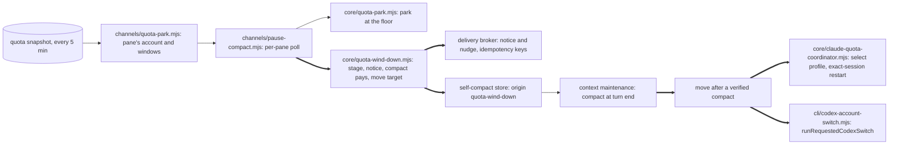
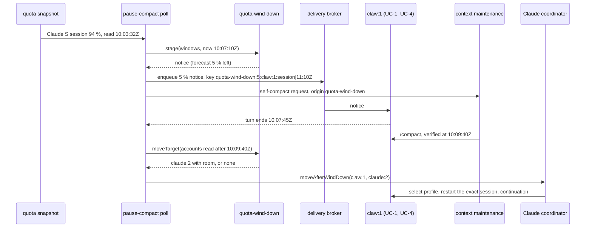
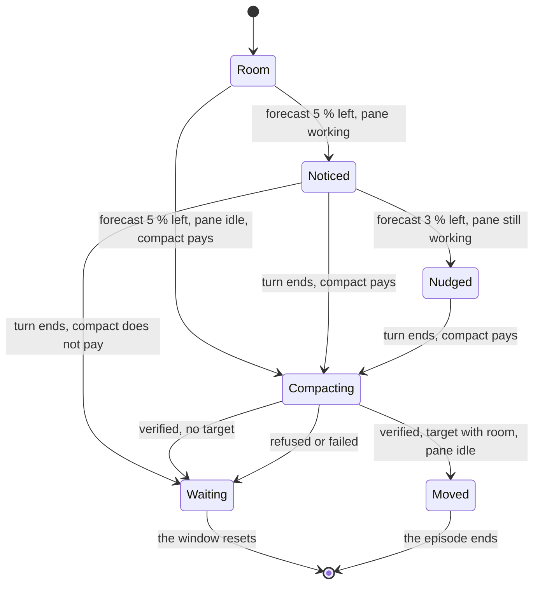

# Quota wind-down: notice at 5 %, nudge at 3 %, compact, then a move to room

Version: 3 · 2026-10-20 22:5xZ · owner of the design: api:0 · page: none yet
<!-- stale: -->

## 1. Goal

His request and yes are in `~/.agentmux/PRIORITIES.md`, "Tillägg 2026-10-20 ~14:5xZ: varning före kvotstopp, kompakt,
sedan byte". He asked that a pane hear a warning when its account has 5 % left, that the orchestrator nudge it once
more around 3 to 2 % so it ends there and compacts, and that it then move to an account with tokens left. lsrc:0's order
to api:0 the same minute (row 55) adds: the nearer of the week and the 5 h session decides; one notice per pane per
episode; a move only to verified room, in the exact session, never mid-turn; reuse the quota floor, park and resume,
the compact-while-cache-lives retry of 1.25.281 and Codex automatic recovery. Proof: a replay of the 10:20Z Claude S
session stop. Mattias asked again at 15:3xZ, after lsrc:0's pane stopped at 15:29Z, whether the protection worked; it
was not built, so that stop is replayed too.

Outcomes:

1. A pane whose account is about to stop it ends its step cleanly and compacts before the stop, when the compact pays.
2. After that compact, the pane moves to an account of its engine with room and keeps working, instead of waiting for
   the reset.

Principles:

- One notice and one nudge per pane per episode, never more.
- A compact only where it pays: the stop outlasts the pane's cache, or a move follows.
- A move only to verified room, in the exact session, with the pane idle and its composer empty.
- Thresholds follow the window's own pace between readings, as the park's `predictedStopAt` does.
- Reuse the park, the floor, self-compaction and the recoveries; no second scheduler.

Non-goals: the human quota warnings at 80 and 90 % (`channels/quota-warning.mjs`) are unchanged; no new account login;
no move on a forecast without a verified compact; Kimi is out.

## 2. UX

n/a: no screen. What changes is two messages a pane receives and the one-line continuation after a move; each is mirrored
to the pane's Discord channel as every amux notice is.

| String | Where | Max length |
|---|---|---|
| `[AMUX QUOTA WIND-DOWN · 5 %] {account} has {left} % of its {window} window left (resets {HH:MM}Z, a week window {Mon D HH:MM}Z). Finish the current step and start no new large one; amux compacts this session when your turn ends.` | pane, at 5 % | 240 |
| `[AMUX QUOTA WIND-DOWN · 3 %] {account} is about to stop. End your turn at the next clean boundary; amux compacts this session then.` | pane, at 3 % | 180 |
| `[AMUX QUOTA WIND-DOWN · MOVED] This session was compacted and moved from {from} to {to}, which has room. Continue the task from the compact summary. Do not repeat an external side effect that already has a receipt.` | pane, after a move | 260 |

## 3. Use cases

- **UC-1, a working pane at 5 %.** claw:1 on Claude S at 10:07:08Z, 2026-10-20 (the window's 5 % point by its pace), mid
  turn. It gets the 5 % notice, ends its turn at 10:07:45Z and compacts at that turn end (about 2 min, a few cents of
  quota). Stage: row 55.
- **UC-2, an idle pane at 5 %.** api:0 at 10:07:08Z, idle since 09:59Z with 577k tokens. No notice (a notice would start
  a turn); it compacts at once, as the park does for an idle pane. The 577k cold read at 11:11Z does not happen. Stage:
  row 55 (the park's lead of 1.25.280 already covers most idle panes). No sequence: UC-1's calls without the notice.
- **UC-3, still working at 3 %.** lsrc:2 at 10:12:07Z, working since 09:56Z. It gets the nudge once; if its turn does
  not end before the stop, nothing more is sent. Stage: row 55. No sequence: UC-1's calls plus one more enqueue.
- **UC-4, a move after the compact.** A pane compacted at 15:20Z while Claude S has 2 % of its session left, and another
  Claude account has 40 % of its week and 90 % of its session left. The pane, idle with an empty composer, moves there
  in its exact session and continues; the move reads the compacted context once (about 65k) on the new account. Stage:
  row 55. On 20 Oct no Claude account had room at either stop (claude:2 at 97 % of its week, wetterlind at 100 %).
- **UC-5, a short stop and no room elsewhere.** 15:29:37Z, reset 16:10Z: the stop (41 min) is shorter than the cache
  (60 min) and no account has room. Panes get the notice and the nudge for a clean stop, but no compact: their warm
  restart costs less than a compact. Stage: row 55. No sequence: UC-1's calls without the compact.
- **UC-6, a Codex pane.** Codex windows (300 and 10 080 minutes) give the same stages; the cache life is 25 minutes,
  so a compact pays for more stops. A move uses the per-pane Codex switch. Stage: row 55. No sequence: UC-1 and
  UC-4's calls, with `runRequestedCodexSwitch` in place of the coordinator.
- Unhappy cases:
  - **Missing or stale reading:** no reading, or none newer than 10 minutes, sends nothing and moves nothing.
  - **The compact fails or is refused:** no move; the 1.25.281 retry after the reset still applies.
  - **The target loses room** between the choice and the move: the move re-reads the target and stops.
  - **The pane is busy, its composer holds text, or a delivery is live:** no move; the next poll tries again within
    the episode.
  - **His own message is queued:** it is never held; the notice and the nudge wait behind it in the FIFO.
  - **A bridge restart in the middle:** the idempotency keys keep each notice to one; a cut compact is erased by
    1.25.283's abandoned-attempt rule.
  - **Two windows near at once:** the nearer stop decides; the episode is that window's reset.

## 4. Architecture



- Identity: an episode is pane plus the stopping window's kind and reset time (`claw:1|session|2026-10-20T11:10Z`).
- Ownership: `channels/pause-compact.mjs` is the only writer of the wind-down episodes (in memory, keyed like `parked`);
  the notices are durable through the broker's idempotency keys `quota-wind-down:{5|3}:{pane}:{episode}`.
- One exit: notices leave only through `deliveryBroker.enqueue`; a move only through the coordinator's exact-session
  restart (Claude) or `runRequestedCodexSwitch` (Codex).
- Switches: `AMUX_QUOTA_WIND_DOWN=off|dry|on` (default dry until §11's first live stop is read, then on; dry logs
  `would-notice`, `would-compact`, `would-nudge`, `would-move` to `~/.agentmux/pause-compact.jsonl`);
  `AMUX_QUOTA_WIND_DOWN_MOVE=false` keeps the notices and compacts and moves nothing. One reader,
  `readWindDownMode` in `core/quota-wind-down.mjs`, serves the poll and both move paths.
- Invariants:
  - **I-1** At most one notice and one nudge per pane per episode. Enforced in `channels/pause-compact.mjs` (episode
    map and idempotency keys), guarded by `channels/pause-compact.test.mjs`, "one notice and one nudge per episode,
    also across a restart".
  - **I-2** A move needs a VERIFIED compact of this session in this episode, an idle pane with an empty composer and no
    live delivery, and a target with room in both windows read after the compact. Enforced in
    `core/quota-wind-down.mjs` (`moveTarget`) and the coordinator (`classifyClaudeRotationPane` mode running), guarded
    by `core/quota-wind-down.test.mjs`, "no move without a verified compact" and "no move to a target whose session is
    low".
  - **I-3** No compact that does not pay: a stop shorter than the cache with no move gets the notice only. Enforced in
    `compactPays`, guarded by "a short stop with no room gets the notice without a compact" (UC-5).
  - **I-4** His own message is never held. The notices are ordinary FIFO jobs; the floor's exemption for the owner's
    message is unchanged.

## 5. Behaviour (UML)





## 6. Pseudocode

```
windDownStage(windows, now):                          # core/quota-wind-down.mjs, pure
  live = windows with a usedPercent and a reset after now
  if no live window or every reading is older than 10 min: return none
  for each window: left = 100 - used - pace * (now - observedAt)      # pace = used / minutes since it opened
  nearest = the window with the earliest predictedStopAt (QUOTA_PARK_POLICY)
  if left(nearest) <= 3: return { stage: nudge, window, resetAt }
  if left(nearest) <= 5: return { stage: notice, window, resetAt }
  return none
  tests: "notice at the 5 % point between readings", "nudge at 3 %", "the nearer window decides", "stale reading: none"

compactPays({ engine, resetAt, stopAt, lastActivityAt, working, target }):   # pure
  if target: return true                                # a move reads the context cold on the new account anyway
  cacheFrom = working ? stopAt : lastActivityAt
  return resetAt - cacheFrom > QUOTA_PARK_POLICY.outlastMs[engine]
  tests: UC-5 "a short stop with no room gets the notice without a compact", UC-2

moveTarget({ engine, accounts, from, readAfter, reservePercent = 90, sessionFloor = 20 }):   # pure
  candidates = accounts of engine, not from, read after readAfter
  keep those with weekly used < reservePercent and session left >= sessionFloor
  return the one with the most weekly room (accountWithRoom's order), or null
  tests: "no move to a target whose session is low", "no move on a reading older than the compact"

windDownStep(pane):                                    # channels/pause-compact.mjs, inside consider()
  stage = windDownStage(facts.windows, now)
  if stage none or mode off: return
  episode = pane|stage.window|stage.resetAt
  target = moveAllowed ? moveTarget(...) : null
  if stage notice and not noticed[episode]:
    if pane working: enqueue 5 % notice (key quota-wind-down:5:pane:episode)
    if compactPays(...): selfRequests.request(origin quota-wind-down, continuation none)
    noticed[episode] = true
  if stage nudge and pane working and not nudged[episode]: enqueue 3 % nudge; nudged[episode] = true
  if target and a VERIFIED compact of this session ended in this episode and pane idle, composer empty, no live job:
    Claude: coordinator.moveAfterWindDown(pane, target)  # selectProfile, exact-session restart, MOVED continuation
    Codex:  runRequestedCodexSwitch(ctx, name, pane, { to: target })
    moved[episode] = true
  dry mode: log would-notice, would-nudge, would-move instead
  tests: I-1 "one notice and one nudge per episode, also across a restart", I-2 "no move without a verified compact"
```

## 7. Platform limits

| Limit | Value | Kind | Source |
|---|---|---|---|
| Quota snapshot age | at most 5 min (`createQuotaParkFacts` maxAgeMs); readings 10:03:32, 10:08:47, 10:16:10, 10:21:28Z on 20 Oct | measured | `~/.agentmux/quota-budget/claude/*.json` history |
| Claude prompt cache | 60 min (1 h writes) | documented | `QUOTA_PARK_POLICY.outlastMs`, `claude-subagent-cache-2026-10-10.md` |
| Codex prompt cache | about 30 min; amux uses 25 | documented | `QUOTA_PARK_POLICY.outlastMs` |
| Claude compact time | 2 min allowed before the stop; longest of 190 was 294 s | measured (longest), assumed (2 min) | `core/verified-compact.mjs` comment; the replay's assumption |
| Session window | 5 h from its reset minus 5 h | documented | `QUOTA_PARK_POLICY.windowMs` |
| Context after a compact | about 65k | measured once | skybar:1 at 11:11Z on 20 Oct (sandman:0) |

## 8. Alternatives

| Option | Cost per stop | Build | Decided by | Reopen when |
|---|---|---|---|---|
| A. Thresholds on readings only | same as B | 2.5h | the nudge at 3 % came at 10:16:10Z, 3.5 min before the stop | readings come every minute |
| B. Thresholds on the window's pace between readings (chosen) | a notice and a nudge per pane | 3h | the 5 % and 3 % points land on time between 5-min readings | the pace forecast misses by more than a reading in a replay |
| C. Keep today's park and the 1.25.281 retry (what already worked) | the stop and its wait remain | 0 | panes still stop mid-step and wait for the reset | no account ever has room at a stop for a month |

## 9. Risks

- **R-1** The notice lands in a long step and the pane stops it early. Likely low, cost a step. Mitigation: the text
  says finish the current step. Detection: the replay's turn ends; `pause-compact.jsonl` lines `wind-down-notice`.
  Fallback: `AMUX_QUOTA_WIND_DOWN=dry`. Owner: api:0.
- **R-2** A move to an account that stops again within minutes. Mitigation: both windows need room, read after the
  compact. Detection: test "no move to a target whose session is low"; a second wind-down episode within 30 minutes of a
  move is logged. Fallback: `AMUX_QUOTA_WIND_DOWN_MOVE=false`. Owner: api:0.
- **R-3** A compact that does not pay costs a call and the pane's memory. Mitigation: `compactPays`. Detection: UC-5 test.
  Fallback: dry mode. Owner: api:0.
- **R-4** Duplicate notices after a bridge restart. Mitigation: broker idempotency keys. Detection: I-1 test with a fresh
  channel instance. Owner: api:0.
- **R-5** A stale or missing reading sends a notice on old numbers. Mitigation: no stage on readings older than 10 min.
  Detection: "stale reading: none". Owner: api:0.
- **R-6** The pace forecast is wrong when use speeds up near the end. Mitigation: re-evaluated each poll; the floor and
  park still stop work at 3 %. Detection: the replay compares forecast and reading (15:13:20Z: forecast 6.3 %, read 6 %).
  Owner: api:0.
- **R-8** The bridge stops after a Claude move's restart and before its MOVED continuation is queued: the pane sits
  idle on the new account with its compacted context, and its task waits for the next message. Likely low (a window of
  seconds per move), cost a stalled task. Mitigation, required before `on`: queue the continuation paused before the
  restart and release it after, as `recoverTarget` does for a limit banner, plus a poll step that releases or cancels a
  paused one after a restart. Detection: a component test that cuts the move after the restart. Fallback:
  `AMUX_QUOTA_WIND_DOWN_MOVE=false`. Owner: api:0. Codex is covered: its move is a durable per-pane request.
- **R-7** A move while the pane works or types. Mitigation: `classifyClaudeRotationPane` must say running (idle, empty
  composer, no live delivery, known session). Detection: test "no move while busy or drafted". Owner: api:0.

## 10. Cost and time

Replay of today's two Claude S session stops (a scratch replay script over the events log, not in the repository; the 5 %
and 3 % points are *estimated* from each window's average pace and agree with the 15:13:20Z park reading; turn ends and
the panes stopped are *measured*):

| Stop | Panes stopped | Notices / nudges | Compacted before the stop | Cold writes after the reset | Saved |
|---|---|---|---|---|---|
| 10:19:37Z, reset 11:10Z | 17 | 11 / 6 | 13 | 1.37M (api:0 577k, claw:2 606k, ai:1 190k; sandman:0) | about 1.18M *estimated*: all three compact first and restart from about 65k each |
| 15:29:37Z, reset 16:10Z | 13 | 7 / 4 | 6, the panes idle at 5 % (10 with a move: the 7 working ones' caches outlive the 40-minute stop) | 0 (*measured*: no restart after 16:10Z paused over 55 min) | 0; the stop was shorter than the cache |

- Fixture: `test/fixtures/quota-wind-down-20261020.json`, made by api:0's scratch replay over the events log, not by
  the build. Per stop: opened, stop, reset, the 5 % and 3 % points; per pane: working at the 5 % point, last activity
  before it, first turn end after it, nudged, compact pays (§6, no move target) and compacted before the stop; and
  `expectedCompacted`: stop 1 ai:0, ai:1, ai:2, api:0, claw:0, claw:1, claw:2, lsrc:0, lsrc:1, skydive:0, skydive:1,
  skydive:2, skyvw:2 (13); stop 2 claw:0, claw:2, lsrc:0, lsrc:2, skyvw:0, skyvw:1 (6).
- Moves: none possible on 20 Oct; at both stops claude:2 had 97 % of its week used and wetterlind 100 %.
- Not compacted before stop 1: lsrc:2, skyvw:0, skyvw:1 (no turn end) and skybar:1 (turn end 10:17:43Z, too late for a
  2-minute compact); none of them restarted cold.
- Cost per episode: one notice per pane (one short turn when working, none when idle), at most one nudge, one compact
  when it pays.
- Time, from the file list: `core/quota-wind-down.mjs` (about 110 lines) and its test (about 120), 1.2h;
  `channels/pause-compact.mjs` wiring (about 35 lines) and tests, 0.8h; the move in `core/claude-quota-coordinator.mjs`
  (`moveAfterWindDown`, about 40 lines) and the Codex call, 0.8h; rule 3 and the amux-accounts skill text, 0.2h. Total
  *estimated* 3h; the coordinator's restart path dominates.

## 11. Rollout and rollback

- Order: release dry (the code default, since the bridge's env file holds secrets) for the first stop it sees, read the
  dry lines against the replay, close R-8, then release with the default `on` (his yes covers the moves). Everyone at
  once.
- Switches: `AMUX_QUOTA_WIND_DOWN=off|dry|on`; `AMUX_QUOTA_WIND_DOWN_MOVE=false`.
- Turning it off leaves nothing behind: the episodes are in memory, the notices are ordinary acknowledged jobs.
- Migrations: none.
- Texts in the same release: staffing rule 3's "Account recovery moves a pane only at a reached weekly limit, ...;
  forecasts never switch" gains the verified wind-down compact as the second trigger; the amux-accounts skill's
  "Warnings and forecasts never switch" and "A session window never moves a pane" get the same exception.
- Rollback: install the previous release SHA with `bin/install-release.mjs`.

## 12. Tests

| Changed path | Tests that run |
|---|---|
| `core/quota-wind-down.mjs` | `core/quota-wind-down.test.mjs` |
| `test/fixtures/quota-wind-down-20261020.json` | `core/quota-wind-down.test.mjs` |
| `channels/pause-compact.mjs` | `channels/pause-compact.test.mjs` |
| `core/claude-quota-coordinator.mjs` | `core/claude-quota-coordinator.test.mjs` |
| `core/hints-fleet-process.mjs` | `test/agent.test.mjs`, `test/hints-budget.test.mjs` |

| Test | Guards | Level | Write min | Run s |
|---|---|---|---|---|
| `core/quota-wind-down.test.mjs` | UC-1, UC-2, UC-3, UC-5, I-2, I-3, R-2, R-5, R-6 | unit | 25 | 1 |
| `channels/pause-compact.test.mjs` | I-1, R-4 | component | 10 | 2 |
| `core/claude-quota-coordinator.test.mjs` | UC-4, R-7 | component | 8 | 2 |
| `test/agent.test.mjs` | existing: rule 3 names the wind-down move | unit | 2 | 1 |
| `test/hints-budget.test.mjs` | existing: hints stay within 16 384 bytes | unit | 0 | 1 |

- Budget: write 45 min of the 180 min of build (25 %); targeted run 7 s.
- Full proof: the move restarts a pane's exact session; its guards (I-2, R-7) are tested one by one in
  `core/claude-quota-coordinator.test.mjs`.
- Touched tests: none expected to change; the rule 3 pin in `test/agent.test.mjs` is extended, not replaced.
- Hardest case: the replay of both 20 Oct stops through the real `windDownStage` and `compactPays`, in dry mode. Input:
  readings every 5 min on each stop's average pace (0 % at `opened`, 100 % at `stop`; *estimated*, the session window's
  own readings are not kept) and the fixture's per-pane facts. Output must equal the fixture's `expectedCompacted`.
- Threshold example for "notice at the 5 % point between readings": window opened 06:10Z, 94.0 % used read at
  10:03:32Z (as in §5): no notice at 10:03:32Z (6 % left), a notice at 10:07:10Z (4.54 % forecast). That reading's own
  5 % point is 10:06:01Z; UC-1's 10:07:08Z comes from the stop's average pace.
- Rehearsal step: the dry replay on the installed release over that stop's events, cap 60 s.
- Fixtures: a session window between readings, a week and a session both near, a stale reading, a pane idle at 5 %, a
  pane working through the stop, a compact refused at the limit, a target with week room but a low session, a bridge
  restart between the notice and the nudge.
- Browsers and devices: n/a. Live categories touched: none (a move uses accounts he already logged in).
- Small first:
  - [ ] Pieces: n/a: until the build; each stage test runs on one window object.
  - [ ] Edge cases: n/a: until the build; the fixtures carry two near windows, a stale reading and a low target session.
  - [ ] Seams: n/a: until the build; the broker and the coordinator run for real in the component tests.
  - [ ] Whole path: n/a: until the build; the dry replay over the 10:19:37Z stop.
  - [ ] Big input last: n/a: until the build; the next real stop, in dry mode first.

## 13. Tasks

| # | Task | Owner | State | Prio | Estimate | Spec | Done when |
|---|---|---|---|---|---|---|---|
| 55 | Quota wind-down: notice at 5 %, nudge at 3 %, compact when it pays, then a move to room | api:0 | open: design v1, builder next | P1 | 3h | [Wind-down §6](DESIGN-quota-wind-down.md#6-pseudocode) | the dry replay of 20 Oct 10:19:37Z names the same 13 panes as §10 on the installed release |

## 14. Open questions

None for him; his yes covers the moves. Calls made by api:0:

- Thresholds follow the window's pace between readings (option B), since 5-minute readings put the 3 % nudge 3.5
  minutes before the stop.
- An idle pane gets no notice; it compacts at once when that pays, as the park does.
- A move needs room in both windows of the target (week under the 90 % reserve, at least 20 % of the session), read
  after the compact.

## 15. Changes

- v1, 2026-10-20 16:5xZ: first version, from his 14:5xZ request and lsrc:0's row 55 order; the replay of both 20 Oct
  stops in §10.
- v2, 2026-10-20 17:3xZ: the replay fixture with per-pane facts and expected panes (§10, §12) and the threshold example
  with 94.0 % (§12); stop 2 compacts 6 without a move, not 10, once `compactPays` is applied. Why: api:6 stopped
  before code on a 95.0 % example in my brief that contradicts §6 and on §10 lacking per-pane data. Told: api:6.
- v3, 2026-10-20 22:5xZ: the first release defaults to dry in code (§4, §11), dry also logs `would-compact` so a live
  stop can be checked against the replay, a week notice names its reset day (§2), and R-8 (a Claude move cut after its
  restart) must close before `on`. Why: api:0's review of api:6's build 9218922d; the env file is not edited by agents.
  Told: api:6.
