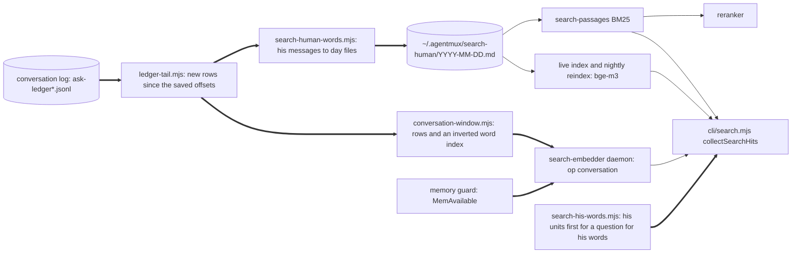
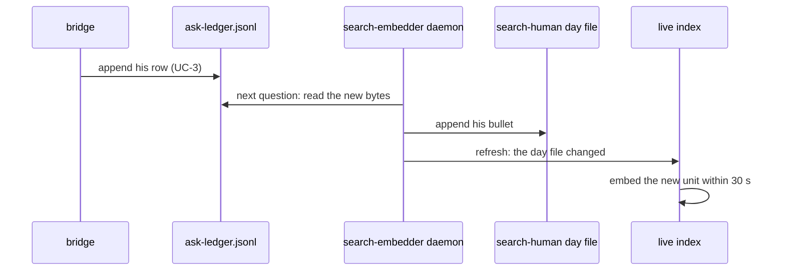

# amux search: his messages as units, the conversation log in the daemon, 30 minutes warm while memory is free

Version: 10 · 2026-10-20 16:3xZ · owner of the design: api:0 · page: none yet
<!-- stale: -->

## 1. Goal

lsrc:0's decision on his question of 20 Oct (daily log 2026-10-20, lsrc:0's headings on amux search), from sandman:0's
review of 20 Oct (https://claude.ai/artifact/5zFCbJGLAyRyRMShphPAbp). In the review, the 47 blind round-6 questions
(sha256 bae5e685) give 94 % hit@3 and 87 % hit@1 warm on 1.25.274. The median is 5.46 s and p95 is 9.14 s, against
1.18 s on 10 Oct. 3.9 s of that is the conversation-log scan from f568d7c0, which reads all 238 MB on every question.
18 of 69 real searches in 48 h ran cold, because the daemon closes after 2 minutes, and the cold path gives 70 % hit@3.

His questions of 20 Oct 07:12Z about the memory a warm daemon holds, and his answer at 07:26Z that leaves the choice to
api:0 and asks for everything to be written down (daily log 2026-10-20, api:0's heading on the search daemon's
memory), add outcome 3.

After 1.25.277, lsrc:0 asked why his exact words still do not come first (v14 to v16 stayed at 33 %). The cause,
measured 09:2xZ: his units never hold his name, so "vad sa Mattias om …" favours notes that say it; voice splits one
thought over several messages; and 1 398 of the 8 303 units were automation typed into panes. lsrc:0's order of
09:3xZ adds outcome 4 and asks how Dream's answer statistic moves, with the same proof before and after.

After 1.25.279 (v14 to v16 hit@3 33 to 67 %, hit@1 33 to 0 %), lsrc:0 asked at 12:2xZ that a question for his words
rank his own units above agent rows that quote him, with those rows kept below as context: v14 to v16 at hit@1 and
no loss on the 47, the same proof (outcome 5, row 53).

The outcome:

1. The daemon follows the canonical conversation log incrementally and reads only new lines. His messages become
   their own searchable units in the same layers as the notes (BM25, bge-m3, the reranker), so his exact words can
   come up in step one. No question rescans the whole log.
2. The daemon stays warm for 30 minutes after the last search, not 2.
3. The daemon holds memory only while the machine has room. It does not start without room for its peak, and it
   closes when free memory falls under a floor.
4. His units name him, his messages to one pane within about 2 minutes also form one joined unit (the single units
   stay), and no automation counts as his: amux's own notices, and long prompts repeated 3 or more times.
5. A question for his words (what he said, asked, wrote or decided; his words, his decision; verbatim) lists his own
   units first, in the order the ranking gave them. Notes, the conversation log and the ledger follow as context.

Principles, in the order they decide:

1. Same answers, less time. A change that loses hit@1 or hit@3 on the 47 blind questions does not ship.
2. No memory the machine needs. The daemon gives its RAM back before anything else runs short; a cold answer is the
   price.
3. One writer per derived file. The log stays the only source; derived files can always be rebuilt from it.
4. Reuse the note pipeline. His messages become Markdown units, so parsing, BM25, the live overlay, the nightly
   reindex, the reranker and `--show` work unchanged.
5. Honest output. A layer that did not run says so on the result, as the semantic layer does today.

Non-goals:

- No PRIORITIES.md root, no correction links and no recency weight. Those are the review's items 2, 3 and 5.
- No model change, and no history beyond the conversation log's 30-day window.

## 2. UX

n/a: a command-line tool with no screens. The result lists keep their form. What changes for the reader:

| Place | Product text | Max length | Stage |
|---|---|---|---|
| Result source of a message of his | `~/.agentmux/search-human/2026-10-20.md:14` and the snippet `**HH:MM:SSZ agent:pane voice** <his words>` | 220 | v1 |
| The same, with his name (v7) | `**07:07:54Z Mattias to lsrc:0 voice** <his words>` | 220 | v7 |
| A joined unit (v7) | `~/.agentmux/search-human/2026-10-20.joined.md:3` and `**07:07:54Z to 07:08:14Z Mattias to lsrc:0, 2 messages** <his words>` | 240 | v7 |
| Warning when the daemon is cold and no `--source conversation` | `ℹ conversation log is searched by the warm search daemon, which is not up; this answer leaves it out` | 110 | v1, words v4 |
| `amux search --help` | "The search daemon stays loaded for 30 minutes after the last question" in place of "exits when idle" | 80 | v1 |
| `amux search --help`, appended to the line above | ", while at least 8 GB RAM is free" | 40 | v2 |
| Notice when the guard keeps the daemon down | `⚠ 6.2 GB RAM free, the search daemon starts at 13 GB; lexical only this time` | 110 | v2 |
| The daemon's line in `~/.agentmux/search-embedder.log` when it closes for memory | `search-embedder: closing, 7.4 GB RAM free is under the 8 GB floor` | 80 | v2 |

## 3. Use cases

- **UC-1 Warm question.** An agent runs `amux search "vad sa Mattias om autocompact-gränsen"` while the daemon is up.
  - Today the answer takes 5.46 s median, 3.9 s of it scanning 238 MB of log.
  - After: the daemon answers the conversation step from memory in under 50 ms, and the median is about 1.6 s
    (*estimated*: 5.46 − 3.9).
  - Cost: no network, no money. Stage v1. Sequence: §5 seq-warm.
- **UC-2 His exact words in step one.** An agent asks `amux search "vad sa Mattias exakt om att Opus planerar och
  Sonnet utför"`.
  - His 19 Oct message on who carries out plans is a unit in `search-human/2026-10-19.md`. It competes in BM25,
    bge-m3 and the reranker like a note bullet, and `--show N` prints it whole with its time and pane.
  - Today the same words come only from the word-AND step, after the agents' rows.
  - Stage v1. Sequence: §5 seq-warm.
- **UC-3 A new message.** He writes to a pane at 10:00:00Z, and an agent searches for it at 10:00:40Z.
  - The bridge appends the row. The next question makes the daemon read the new bytes, add the bullet to the day file
    and index its words. The live overlay embeds it within its 30 s scan, so it is found lexically at once and
    semantically within about 30 s.
  - Stage v1. Sequence: §5 seq-new.
- **UC-4 Cold question.** The first question after 30 minutes idle.
  - The CLI starts the daemon in the background and answers with notes and his messages through BM25. The agents'
    conversation rows are left out, and a warning says so.
  - With `--source conversation` the CLI still scans the log as today, because the reader asked for it.
  - Stage v1. Sequence: §5 seq-cold.
- **UC-5 Night.** The nightly reindex first brings the derived files up to date, then embeds them on the GPU with
  the notes. Stage v1. No sequence: one local process, no new boundary.
- **UC-6 Memory runs short.** A build fills RAM until 7 GB is free while the daemon is warm.
  - Within 30 s the daemon closes, after any question in flight, and gives back about 3 GB RAM and 2.3 GB VRAM
    (*measured* warm, §7). `~/.agentmux/search-embedder.log` says why.
  - Questions get the cold answer with the guard's notice until 13 GB is free; none of them starts the daemon.
  - Cost: cold answers (70 % hit@3) while memory is short. Stage v2. No sequence: each process reads
    `/proc/meminfo` itself, no new boundary.
- **UC-7 A question for his words.** An agent asks for his words on the quota floor (v14), with his name and
  "ordagrant" in the question.
  - On 1.25.279 the top 9 are agents' notes and ledger rows; his 19 Oct message with the words ranks 26th of 40.
  - After: `asksForHisWords` holds, so his units in the reranked list come first, in their order, and the notes
    follow. The prototype on 1.25.279 (*estimated*, §10): v14 from no hit to 1, v15 from 3 to 1, v16 stays at 2.
  - A question without that intent keeps today's order; none of the 47 has it.
  - Cost: one regular expression over the question and a stable partition, under 1 ms. Stage v9. No sequence:
    inside `collectSearchHits`, no new boundary.
- **Unhappy cases:**
  - Log rotation (a 32 MB file is renamed and a new `ask-ledger.jsonl` starts): the reader follows the renamed file
    by inode to its end, then starts the new file at 0.
  - A partial last line, mid-write: kept as a remainder and parsed when its newline arrives.
  - A rewritten log (size smaller than the saved offset, or an unknown inode at a known path): read again from 0.
    Duplicates are dropped by row id.
  - Two callers at once (the daemon, the CLI cold path and the reindex): one file lease. Whoever does not get it
    reads the files as they are.
  - Disk full while appending a day file: the error surfaces once. The offset is saved only after a successful
    write, so nothing is lost.
  - A delivery and its pane-hook copy: one unit, by the same rule as `coalesceAskLedger` (same agent, pane and
    authored text within 15 minutes).
  - Agents' briefs (`[from …]`), task notifications and system wrappers are never his units (`inferAskOrigin`,
    `isSystemNoiseDirective`).
  - The daemon dies mid-session: the next question is cold (UC-4) and restarts it.

## 4. Architecture



- Identity:
  - a log row is its `id`;
  - a unit of his is the bullet carrying that `id`;
  - a log file is its inode, never its path, because rotation renames it.
- Ownership:
  - `search-human-words.mjs` is the only writer of `~/.agentmux/search-human/` and its `state.json`, under one file
    lease;
  - `conversation-window.mjs` owns the daemon's rows and index.
- One exit: n/a: nothing leaves the machine. The derived files are mode 600 in `~/.agentmux`, like the log.
- Switches:
  - `AMUX_EMBEDDER_IDLE_MIN` decides how long the daemon stays up after the last question (default 30, was 2);
  - `AMUX_SEARCH_HUMAN=0` leaves the human root out of every search and stops the sync;
  - `human.name` in `~/.agentmux/agentmux.yaml` is the name his unit headers carry ("Mattias" here); unset, the
    headers carry none;
  - `AMUX_EMBEDDER_MIN_FREE_GB` decides the memory floor (default 8). The daemon starts only with the floor plus
    5 GB free, because its peak was 3.8 GB and the conversation window adds about 0.5 GB (§10), and closes within 30 s when free memory falls under the floor.
    0 turns the guard off.
- Invariants:
  - **I-1** No question reads a log byte twice in a warm daemon. Enforced in `ledger-tail.mjs`, guarded by
    `core/ledger-tail.test.mjs`, "reads only bytes appended since the last call".
  - **I-2b** (v7) A message joins one joined unit when his previous message to the same pane came 2 minutes or less
    before it; nothing that amux typed into a pane, and no long prompt repeated 3 or more times in the window, is his.
    Enforced in `search-human-words.mjs` and `ask-origin.mjs` (`humanAsksOf`), guarded by the v7 tests in §6.
  - **I-2** Each message of his is exactly one unit (split only by the 1 600-character cap), with its words unchanged
    apart from the bridge's voice prefix. Enforced in `search-human-words.mjs`, guarded by
    `core/search-human-words.test.mjs`, "writes each message of his once, word for word".
  - **I-3** Warm conversation hits equal what `searchConversationLog` returns for the same rows. Enforced in
    `conversation-window.mjs`, guarded by `core/conversation-window.test.mjs`, "finds the same rows as the scan".
  - **I-4** The daemon never starts without room for its peak, and never stays more than 30 s under the floor, plus a question in flight.
    Enforced in `core/search-embedder.mjs` (`memoryRoom`), guarded by `core/search-embedder-lifecycle.test.mjs`,
    "does not start without room for its peak" and "closes when free memory falls under the floor".
  - **I-5** (v9) A question for his words reorders the ranked hits and drops none: his units first in their order,
    then every other hit in its order. Any other question keeps today's order. Enforced in `search-his-words.mjs`,
    guarded by `core/search-his-words.test.mjs`, "puts his units first and keeps every hit", and
    `cli/search.test.mjs`, "keeps the order of every other question".

## 5. Behaviour (UML)

```mermaid
%% id: seq-warm
sequenceDiagram
  participant A as agent
  participant C as cli/search.mjs
  participant D as search-embedder daemon
  participant T as ledger-tail.mjs
  participant L as ask-ledger.jsonl
  A->>C: amux search "question" (UC-1, UC-2)
  C->>D: op conversation, query
  D->>T: tail()
  T->>L: read from saved offset to end
  L-->>T: new bytes only
  T-->>D: new rows
  D->>D: human sync appends day files; window adds rows to the word index
  D-->>C: conversation hits
  C->>D: passages, semantic, rerank, as today
  D-->>C: ranked units, his messages among them
  C-->>A: hits #1 to #12
```



```mermaid
%% id: seq-cold
sequenceDiagram
  participant A as agent
  participant C as cli/search.mjs
  participant H as search-human-words.mjs
  participant D as search-embedder daemon
  A->>C: amux search "question", daemon down (UC-4)
  C->>D: connect fails
  C->>D: start in the background
  C->>H: sync under the lease (new bytes only)
  C->>C: BM25 over notes and his day files; no conversation scan unless --source conversation
  C-->>A: hits, with the warning that the conversation log was left out
```


## 6. Pseudocode

```
tail(state, files):                                   # ledger-tail.mjs
  for file in ledger spans in time order:
    id = inode(file); known = state[id]
    if known and known.size > size(file): known = none     # rewritten: read again, ids dedupe
    start = known ? known.offset : 0
    if start == size(file): continue                         # nothing new: no read
    bytes = read(file, start, size - start)
    text = known.remainder + bytes; lines = complete lines; remainder = after the last newline
    rows += parse(lines) where row.version is current
    state[id] = { path: file, size, offset: size - len(remainder), remainder }
  forget state entries whose inode no longer exists
  return rows
  # tests: ledger-tail.test.mjs "reads only bytes appended since the last call",
  #        "follows a rotated file by inode", "keeps a partial line until it ends", "reads a rewritten file again"

syncHumanWords(dir, now):                             # search-human-words.mjs
  lease = acquire(dir/.lease) or return "busy"
  rows = tail(state.tail, spans since now - 30 days)
  for ask in rows where isHumanAsk(ask) and ts within the window:
    text = authoredPromptText(ask.verbatim) without the bridge voice prefix
    if seen(ask.id) or a written ask has the same agent, pane and text within 15 min: continue
    append "- **HH:MM:SSZ agent:pane[ voice]** text" (continuation lines indented 2) to dir/<UTC date>.md
    remember (ask.id, agent, pane, hash(text), ts)
  delete day files older than 30 days; prune the remembered keys to the window
  save state only after every append succeeded; release lease
  # tests: search-human-words.test.mjs "writes each message of his once, word for word",
  #        "drops agents' briefs and system wrappers", "merges a delivery with its pane-hook copy",
  #        "deletes days past the window", "resumes after a failed append without losing a message"

v7 changes to syncHumanWords and isHumanAsk:          # search-human-words.mjs, ask-origin.mjs
  a state.json of an older format version -> delete the day files and state, then rebuild from the log
  header = "- **HH:MM:SSZ <human.name> to agent:pane[ voice]** "   (no name when human.name is unset)
  humanAsksOf(asks in the window):                    # ask-origin.mjs, also used by answeredShare
    keep isHumanAsk(ask), where isHumanAsk now also refuses a prompt that starts with one of amux's own tags
      (every bracket tag amux types into a pane, collected from its send sites, for example [stall-watch])
    drop every ask whose authored text, 40 characters or longer, occurs 3 or more times among the window's asks
  a text that reaches 3 copies -> its copies already written leave the day files
  joined: for each day that changed, rewrite <day>.joined.md from that day's bullets: runs of his messages to the
    same pane with gaps of 2 minutes or less, 2 or more messages, one bullet each
    "- **HH:MM:SSZ to HH:MM:SSZ <name> to agent:pane, N messages** " + the texts, one per indented line
  # tests: "writes his name in each unit's header", "joins his messages to one pane within 2 minutes and keeps the
  #        singles", "keeps amux's own notices out", "keeps a prompt repeated three times out and removes its copies",
  #        "rebuilds the day files when their format changes"; dream-conversation.test.mjs
  #        "answeredShare counts no amux notice or repeated prompt as his"

conversationWindow.search(query, max):                # conversation-window.mjs (daemon)
  add(tail(...)) first: rows into the 30-day window, tokens into an inverted index (token -> row ids)
  words = unique searchTokens(query); empty -> []
  for word: rows matching tokenMatches(word, token) for any indexed token (exact, or a 4+ letter prefix either way)
  candidates = intersection over words; drop rows older than 30 days
  score each as searchConversationLog does; sort and cut to max
  assert result equals searchConversationLog over the same rows        # I-3
  # tests: conversation-window.test.mjs "finds the same rows as the scan", "finds a row appended after warm-up"

collectSearchHits conversation step:                  # cli/search.mjs
  if daemon answers op conversation: ledgerHits += its hits
  else if flags.source names conversation: ledgerHits += searchConversationLog(content)      # explicit request
  else: warn the conversation log was left out; syncHumanWords() so his day files are current
  # tests: search.test (cli) "uses the daemon's conversation hits when it is warm",
  #        "leaves the scan out when cold unless --source conversation"

memoryRoom(needGb):                                   # search-embedder.mjs
  floor = AMUX_EMBEDDER_MIN_FREE_GB (default 8); floor == 0 -> { room: true }          # guard off
  free = MemAvailable of /proc/meminfo, in GB
  unreadable -> { room: true }, and the daemon logs "memory guard off: no /proc/meminfo" once
  return { room: free >= needGb, free }

startEmbedder():
  lease busy or a legacy worker -> as today, "owner busy or starting"   # first: a loading daemon lowers MemAvailable
  r = memoryRoom(floor + 5)
  not r.room -> return { unavailable: "<free> GB RAM free, the search daemon starts at <floor + 5> GB; lexical only this time" }
  spawn as today, stderr appended to ~/.agentmux/search-embedder.log, which moves to .log.1 past 1 MiB

daemon, every 30 s while up (unref'd timer):
  not memoryRoom(floor).room -> log "closing, <free> GB RAM free is under the <floor> GB floor";
                                close at the first moment no question is in flight, by the idle timer's close,
                                without waiting for background loading: that loading is what holds the memory
  # tests: search-embedder-lifecycle.test.mjs "does not start without room for its peak",
  #        "closes when free memory falls under the floor", "a floor of 0 turns the guard off",
  #        "reports the owner as busy, not memory, while another process loads",
  #        "keeps the daemon's log and moves it aside past 1 MiB"

asksForHisWords(query, name):                        # search-his-words.mjs (v9)
  name = cleanHumanName(name); name empty -> false     # no configured name, no intent
  who = name | "han" | "he"
  true when the query holds, case-insensitive and as whole words, any of:
    ("vad" | "hur") + ("sa" | "sade" | "skrev" | "bad" | "tyckte" | "ville" | "menade" | "beslutade" | "bestämde") + who
    name + ("ordagrant" | "exakt" | "citat")
    "hans" + optional ("egna" | "exakta") + ("ord" | "beslut")
    "sa han"
    name + optional "s" + "beslut"
    "what did" + who + ("say" | "ask" | "write" | "decide" | "want")
    (name + "'s" | "his") + optional ("own" | "exact") + ("words" | "decision")
    name + "verbatim"
  # tests: search-his-words.test.mjs "finds each Swedish and English form",
  #        "is false for another pane's words and a word that only contains his name", "is false without a name"

hisWordsFirst(hits, humanDir):                       # search-his-words.mjs
  his = hits whose path is under humanDir; rest = the others
  return his + rest, each in its own order               # I-5: nothing dropped, nothing added
  # tests: search-his-words.test.mjs "puts his units first and keeps every hit"

collectSearchHits, his words:                        # cli/search.mjs
  intent = asksForHisWords(query, the human root's humanName)   # the question as typed, before temporalIntent
  intent -> ranked = hisWordsFirst(ranked) before the cut to max, so a unit of his ranked 26th still enters;
            after the merge with lexical, ledger and conversation hits, hits = hisWordsFirst(hits)
  # tests: search.test (cli) "puts his units above agent rows for a question for his words",
  #        "keeps the order of every other question"
```

## 7. Platform limits

- Log size: 238 MB in 30 days, 9 files, 28 337 asks and 266 929 rows. *Measured* by sandman:0, 20 Oct.
- Rotation at about 32 MB: the active file is renamed and keeps its inode. *Measured*: `ls -l ~/.agentmux/ask-ledger*`,
  20 Oct, files of 33 554 527 to 33 556 189 bytes. Same filesystem, so rename keeps the inode (*documented*:
  rename(2)).
- His messages: about 7 400 in 30 days, about 2 million characters. *Measured* by sandman:0. A first count of mine
  over all files gave 8 854 in October, before the pane-hook copies merge, so the builder reports the real count.
- Daemon memory on 1.25.275, *measured* 07:15Z (`~/.agentmux/artifacts/search-daemon-2026-10-20/warm.log`): 1.67 GB
  RSS before the models, 1.95 GB with the query model, 2.8 to 2.9 GB warm with the GPU reranker, 3.4 to 3.8 GB while
  the live overlay embedded the day's changed notes, peak 3.81 GB. It was 4.1 GB on 10 Oct.
- GPU: RTX 3090, 24 GB. 3.94 GB in use without the daemon and 6.25 GB warm, so the reranker holds 2.3 GB. Back to
  3.94 GB when the daemon closed 2 minutes after the last question. *Measured* (`nvidia-smi`), same run.
- CPU: one start with three questions used 323 s user and 16 s system CPU in 192 s. Each start embeds every note
  changed since the nightly reindex again, because the overlay lives only in memory (`core/search-live-index.mjs`).
  *Measured*, same run.
- Cold first question: 9.6 s at load 3. *Measured*, same run.
- Machine: the WSL VM has 54.2 GB, with 39.5 GB available and 12.9 of 16 GB swap used at 07:15Z. *Measured*
  (`free -m`). MemAvailable is the VM's view and does not see pressure on the Windows side. *Documented*: WSL2 runs
  Linux in a VM with its own memory limit (https://learn.microsoft.com/en-us/windows/wsl/wsl-config, `memory`).
- Search pattern: 229 `amux search` calls in the agents' transcripts (Claude and Codex, subagents included) in the
  48 h before 07:15Z. *Measured* (`search_times.py` in the same folder). sandman:0 counted 69 by another method.
- CPU embedding in the live overlay: at most 4 000 units per 30 s scan (`MAX_UNITS_PER_SCAN`). The first backfill
  runs as one GPU reindex instead.
- Load: the machine runs the fleet's tests, load about 20 on 24 cores at 06:5xZ. *Measured*. Timings are compared
  only before and after in the same window, with the load average beside them.

## 8. Alternatives

| Option | Cost per question | Build | Decided by | Reopen when |
|---|---|---|---|---|
| A. As today: scan 30 days on every question | 3.9 s, growing daily | 0 | the cost that the review measured | never |
| **B. Derived Markdown for his words, plus an in-memory word index in the daemon (chosen)** | under 50 ms | 3h | reuses every layer and the reindex; nothing new to rank | the derived files disagree with the log in a test |
| C. His messages as a new unit type inside the semantic index, with no files | under 50 ms | 5h | needs new code in BM25, the overlay, the reranker text and `--show` | the Markdown form loses his words' exactness |
| D. SQLite FTS over the whole log | about 10 ms | 4h | a native dependency, and it gives no semantic units of his | the window grows past 1 GB |
| E. QMD (github.com/tobi/qmd) as the engine | *to be measured*, row 47 | 1h to compare | its keyword mode was tried on 20 Sep: 17/20 first and 20/20 in three on 20 keyword questions, 1/20 on whole questions; its hybrid mode was never tried | he asks for the comparison; then its hybrid mode must beat ours on the 47 blind questions at a similar median |

The approach that already worked was the 10 Oct pipeline at 1.18 s. B is that pipeline with one more root.

Warm time, decided by the table in §10: 30 minutes cuts cold searches from 71 % to 10 %, and the memory guard gives
the RAM back whenever anything else needs it. Reopen when the daemon logs a close for memory more than once a day, or
when he asks for less.

## 9. Risks

- **R-1 His words are changed or lost in the copy.** Possible, costly: the point is exactness.
  - Mitigation: verbatim text, only the bridge's voice prefix removed; offsets saved after the write.
  - Detection: "writes each message of his once, word for word"; the three verbatim questions v14 to v16.
  - Fallback: `--source conversation` still reads the log itself. Owner api:0.
- **R-2 Agents' words are counted as his.** Happened: 1 398 of the 8 303 units of v1 were automation (v7 fixes it).
  - Mitigation: the same predicate as the Dream answer statistic (`HUMAN_ASK_SOURCES` and `inferAskOrigin`), moved
    to one exported function.
  - Detection: "drops agents' briefs and system wrappers".
  - Fallback: `AMUX_SEARCH_HUMAN=0`. Owner api:0.
- **R-3 The daemon's memory grows with the window.** Likely, small.
  - Mitigation: rows keep only the fields the scan uses, and the index holds row ids.
  - Detection: RSS and VRAM measured warm, written in §10.
  - Fallback: shorter window for agents' rows. Owner api:0.
- **R-4 Warm for 30 minutes holds 2.8 to 3.8 GB RAM and 2.3 GB VRAM while no one searches.** Certain, 34 of 48 h.
  - Mitigation: the memory guard (I-4) gives the RAM back when free memory falls under 8 GB.
  - Detection: "closes when free memory falls under the floor"; the closing line in `~/.agentmux/search-embedder.log`.
  - Fallback: `AMUX_EMBEDDER_IDLE_MIN` and `AMUX_EMBEDDER_MIN_FREE_GB`. Owner api:0.
- **R-5 Cold answers lose the agents' conversation rows.** Certain, for the first question after 30 minutes.
  - Mitigation: his messages stay in the cold path through BM25, and the warning says what was left out.
  - Detection: the `--lexical` and cold runs in §12.
  - Fallback: `--source conversation`. Owner api:0.
- **R-6 A rewritten or truncated log duplicates or skips rows.** Unlikely.
  - Mitigation: inode and size checks, dedupe by id.
  - Detection: "reads a rewritten file again".
  - Fallback: delete `state.json`, and the next sync rebuilds. Owner api:0.
- **R-7 The guard flaps: the daemon starts, loads 3.8 GB, falls under the floor and closes, again and again.**
  Possible when free memory sits near the floor.
  - Mitigation: a start needs the floor plus 5 GB, more than the measured peak of 3.8 GB plus the window's 0.5 GB (§10).
  - Detection: "does not start without room for its peak".
  - Fallback: raise `AMUX_EMBEDDER_MIN_FREE_GB`. Owner api:0.
- **R-8 The guard misses memory pressure on the Windows side.** Possible, because MemAvailable is the VM's view (§7).
  - Mitigation: the 30-minute timer still bounds the time the memory is held.
  - Detection: none in the code. His report, or the Windows task manager's figure for the WSL VM.
  - Fallback: a lower `AMUX_EMBEDDER_IDLE_MIN`. Owner api:0.
- **R-9 A weakly related unit of his leads a question for his words** (v9), above the note that answers it.
  Possible: the rule lifts any unit of his in the reranked pool of 30 to 40.
  - Mitigation: only units the first stage and the reranker already let into the pool; the notes stay right below.
  - Detection: v14 to v16 and the 47 before and after (§10); each new miss becomes a verbatim eval question.
  - Fallback: install the previous release. Owner api:0.
- **R-10 The intent fires on a question that is not about his words** (v9), such as one about another pane's words.
  - Mitigation: every form needs his configured name or "han", "hans", "he" or "his" beside the verb or noun.
  - Detection: "is false for another pane's words and a word that only contains his name"; none of the 47 fires.
  - Fallback: narrow the form in `search-his-words.mjs`. Owner api:0.

## 10. Cost and time

- Money: none. Local CPU and GPU.
- Time per question: today 5.46 s median warm (*measured*, review). After: about 1.6 s (*estimated*).
- Daemon resources while warm, *measured* on 1.25.275 (§7): 2.8 to 3.8 GB RSS, 2.3 GB VRAM, and 323 CPU-s for one
  start with three questions. With the conversation window: *to be measured* after v1 and written here.
- The daemon's V8 heap without the models, *measured* 07:5xZ on 617bd0d9 (`heap-check.mjs` in the evidence folder):
  passage cache 432 MB; base index 14 MB, plus 242 MB of vectors outside the heap; conversation window 271 MB
  (320 360 rows, 10.5 M postings). 717 MB of the 1 536 MB cap, so the cap stays. RSS rises 530 MB with the window.
- Warm time against the real pattern (§7, 229 searches in 48 h), with RAM at 4.2 GB while warm, as measured after v1
  (the v2 table used 3 GB). *Measured* pattern, *estimated* average:

| Timer | Cold searches | Warm of 48 h | RAM on average |
|---|---|---|---|
| 2 min (until v1) | 163 (71 %) | 6.3 h | 0.6 GB |
| 10 min | 72 (31 %) | 21.4 h | 1.9 GB |
| 15 min | 50 (22 %) | 26.3 h | 2.3 GB |
| 30 min (chosen) | 24 (10 %) | 34.4 h | 3.0 GB |
| 60 min | 8 (3 %) | 41.7 h | 3.6 GB |

- Starts fall from 163 to 24 per 48 h, and with them the CPU each start spends embedding the day's changed notes
  again. *Estimated* from the code (§7).

### Results, 20 Oct, same machine

*Measured*; reports, samples and scripts in `~/.agentmux/artifacts/search-daemon-2026-10-20/`. Before is b7323525,
the search code of 1.25.275; after is 1.25.277 (7ecf4e59) after the reindex. Load is the 1-minute average at the
start and end of each run.

| Run | Release | Load | hit@1 | hit@3 | MRR | Median | p95 |
|---|---|---|---|---|---|---|---|
| 47 questions, warm | before | 4 to 17 | 87 % | 94 % | 0.91 | 6 983 ms | 18 414 ms |
| 47 questions, warm | after | 6 to 9 | 87 % | 94 % | 0.91 | 1 652 ms | 3 024 ms |
| 47 questions, `--lexical` | before | 17 to 25 | 60 % | 70 % | 0.64 | 6 211 ms | 9 970 ms |
| 47 questions, `--lexical`, daemon warm | after | 8 | 62 % | 68 % | 0.65 | 623 ms | 934 ms |
| 47 questions, cold, no daemon | after | 8 | 62 % | 68 % | 0.65 | 5 665 ms | 9 338 ms |
| v14 to v16, warm | before | 25 | 33 % | 33 % | 0.33 | 7 198 ms | 9 995 ms |
| v14 to v16, warm | after | 8 to 10 | 33 % | 33 % | 0.36 | 2 597 ms | 8 513 ms |
| v14 to v16, `--lexical` | before | 25 to 23 | 33 % | 33 % | 0.33 | 5 921 ms | 9 892 ms |
| v14 to v16, `--lexical` | after | 10 | 33 % | 33 % | 0.33 | 790 ms | 907 ms |
| v14 to v16, cold | after | 9 | 33 % | 33 % | 0.33 | 6 037 ms | 9 768 ms |

- Warm: the same three misses (u06 from rank 4 to 5, u15, u45); the median is 4.2 times and p95 6 times faster.
- Lexical: one more question at rank 1, and u36 falls from rank 3 to 4, because his 29 Sep message about that person
  now ranks first. A weight of 2 for his root changed nothing (the same 62 % and 68 %). Kept by api:0: the warm path,
  which most searches take, loses nothing. Reopen when another lexical question falls.
- Verbatim: v15 moves from no hit to rank 12; v14 and v16 still miss. His words are units, but these three are not
  found by them yet. Not chased in this release.
- Cold: the agents' rows are left out, with the same hits as lexical here. Its 5.7 s is the CLI building the
  passage cache without a daemon, as before this release.
- The daemon with the window, warm: RSS 4.14 to 4.34 GB (peak 4.34 GB) and 2.3 to 2.5 GB VRAM; the 5 GB start
  headroom covers the peak. The reindex with the backfill took 97 s on the GPU for 9 957 new units.
- Time, from the file list:
  - New `core/ledger-tail.mjs` (70 lines) and its test, 45 min.
  - New `core/search-human-words.mjs` (110 lines) and its test, 75 min.
  - New `core/conversation-window.mjs` (90 lines) and its test, 60 min.
  - Changed `core/search-embedder.mjs` (op conversation, idle 30 min, 25 lines), `cli/search.mjs` (20 lines),
    `core/search.mjs` (the human root, 15 lines), `core/ask-origin.mjs` and `core/dream-conversation.mjs` (the shared
    predicate, 10 lines), `core/search-semantic.mjs` (sync before reindex, 5 lines), 45 min.
  - The measurements before and after, 30 min.
  - The memory guard: `core/search-embedder.mjs` (`memoryRoom`, the start check and the 30 s check, 30 lines),
    `cli/search.mjs` (one help line) and three lifecycle tests, 40 min.
  - Total *estimated* 5.2h for Sonnet builders plus 30 min of api:0's review. The eval runs dominate the wall time.

### Results for row 49, 20 Oct

*Measured*, same machine and evidence folder (`*-before49-*`, `*-after49-*`). Before is the installed 1.25.277,
11:11 to 11:14Z; after is 1.25.279 (b41ec5f6) after the reindex, 12:01 to 12:04Z.

| Run | Release | Load | hit@1 | hit@3 | MRR | Median | p95 |
|---|---|---|---|---|---|---|---|
| 47 questions, warm | 1.25.277 | 7 to 10 | 87 % | 94 % | 0.91 | 1 843 ms | 5 488 ms |
| 47 questions, warm | 1.25.279 | 10 to 8 | 87 % | 94 % | 0.91 | 1 895 ms | 5 168 ms |
| 47 questions, `--lexical` | 1.25.277 | 10 to 9 | 62 % | 68 % | 0.65 | 673 ms | 1 136 ms |
| 47 questions, `--lexical` | 1.25.279 | 8 to 11 | 62 % | 68 % | 0.65 | 664 ms | 880 ms |
| v14 to v16, warm | 1.25.277 | 9 | 33 % | 33 % | 0.36 | 1 860 ms | 3 463 ms |
| v14 to v16, warm | 1.25.279 | 11 to 10 | 0 % | 67 % | 0.28 | 2 292 ms | 3 341 ms |
| v14 to v16, `--lexical` | 1.25.277 | 9 | 33 % | 33 % | 0.33 | 824 ms | 861 ms |
| v14 to v16, `--lexical` | 1.25.279 | 10 | 33 % | 33 % | 0.33 | 752 ms | 4 325 ms |

- The 47: the same hits; u06 moves from rank 6 to 7 warm and u13 from 8 to 10 lexical, both outside the top 3.
- Verbatim, warm: v15 rises from rank 11 to 3; v16 falls from 1 to 2 under his joined run to api:0 at 07:11 to
  07:12Z, which names him but not the expected words; v14 still misses.
- lsrc:0's example query, what he said about Caveman and shorter answers: his two messages on it rank 5 and 6,
  where none of his units was in the top 9 before. Ranks 1 to 4 are still agents' rows that quote the query itself.
- Units: 8 315 singles under 1.25.277's rules (the builder's count), 7 292 now, every one headed with his name,
  plus 1 751 joined runs. The reindex embedded 9 093 changed units in 78 s on the GPU.
- Dream's answer share, both trees at 11:53Z: 24 h 364 of 403 (90.3 %) before, 310 of 346 (89.6 %) after; 7 days
  2 491 of 2 677 (93.1 %) before, 2 101 of 2 258 (93.0 %) after. The asks that left are amux's own notices and
  repeated texts, so the share barely moves.
- 1.25.278 wrote every unit without his name: the CLI reads the generated `~/.config/agent/agents.yaml`, and the
  generator carried only `agents`, `search` and `dream`. 1.25.279 carries `human` too (c1b5284d, a test red
  before), and Dream's section parsing moved unchanged to `core/dream-config.mjs` to keep `sync.mjs` under 500 lines.

### Row 53, his units first for a question for his words

- Prototype, *estimated*: the installed 1.25.279 at 12:3xZ, 40 hits per question, the partition applied outside
  the code, scored by the eval's own `firstAnswerRank` over the first 12. v14 to v16: hit@1 0 to 2 of 3, hit@3 2 to 3
  of 3 (v14 from no hit to 1, v15 from 3 to 1, v16 stays at 2). The 47: no question has the intent, hit@1 41 and
  hit@3 44 unchanged.
- v16 stays at 2: both top hits are his. The first is his 07:11 to 07:12Z run to api:0 about the search, the second
  his 05:00Z voice message with the expected words. Their order is the reranker's; both texts fit its 800-character
  input with the words at characters 81 and 245, so no cut explains it. Not tuned: three questions do not justify
  a rule that orders his own units.
- Time, from the file list: new `core/search-his-words.mjs` (40 lines) and its test (60 lines), 40 min;
  `cli/search.mjs` (6 lines) and two tests, 20 min; the proof before and after, 15 min. Total *estimated* 1.3h.
- *Measured*, 20 Oct 16:12-16:16Z, one machine, warm daemon, the three builds run back to back so the corpus is the
  same: 1.25.284 (before), row 53 without the topic-merge reorder (2b913fd4), installed 1.25.285 (after).

| Set | Before | Row 53 without the reorder | After (1.25.285) |
|---|---|---|---|
| v14 to v16 hit@1 / hit@3, MRR | 0 / 67 %, 0.28 | 67 / 100 %, 0.78 | 67 / 100 %, 0.78 |
| v14 to v16 ranks | v14 -, v15 3, v16 2 | v14 1, v15 1, v16 3 | v14 1, v15 1, v16 3 |
| The 47, hit@1 / hit@3, MRR | 87 / 94 %, 0.91 | not run | 87 / 94 %, 0.91, every rank the same |
| v14 to v16 lexical | 33 / 33 % (builder, 1.25.282) | 33 / 33 % (builder) | 33 / 33 %, v14 -, v15 4, v16 1 |

- v16 at 3: every hit above it is a unit of his, most from that day; their order is the reranker's (R-10). The
  builder measured v16 at 2 three hours earlier, before those units existed. The review's reorder of the unranked topic
  merge changed no rank here; it keeps derived topic pages below his units when the reranker did not rank topics.
- Time: the builder's commits landed about 1 h after its brief (12:15 to 13:15Z) against 1.3 h estimated.

## 11. Rollout and rollback

- Order: release, install, stop the daemon, one `amux search --reindex` on the GPU for the backfill, then the
  measurements. Everyone gets it at once.
- Switches: `AMUX_SEARCH_HUMAN=0` leaves the root out, `AMUX_EMBEDDER_IDLE_MIN=2` restores the old timer, and
  `AMUX_EMBEDDER_MIN_FREE_GB=0` turns the memory guard off.
- Turning it off leaves the day files in place. They are derived, never read again, and can be deleted.
- Migrations: none. The semantic index gains the new root's units on its next reindex.
- Texts in the same release: `SEARCH_HELP` (the daemon's lifetime and the human root) and `docs/cli.md`.
- Rollback: install the previous release SHA (5f8a6776) with `bin/install-release.mjs`.

## 12. Tests

| Changed path | Tests that run |
|---|---|
| `core/ledger-tail.mjs` | `core/ledger-tail.test.mjs` |
| `core/search-human-words.mjs` | `core/search-human-words.test.mjs` |
| `core/conversation-window.mjs` | `core/conversation-window.test.mjs` |
| `core/search-embedder.mjs` | `core/search-embedder-lifecycle.test.mjs`, `core/conversation-window.test.mjs` |
| `cli/search.mjs` | `cli/search.test.mjs` |
| `core/search.mjs` | `core/search.test.mjs` |
| `core/ask-origin.mjs` | `core/search-human-words.test.mjs`, `existing ask-origin and dream-conversation tests` |
| `core/dream-conversation.mjs` | `existing ask-origin and dream-conversation tests` |
| `core/search-semantic.mjs` | `core/search-semantic.test.mjs` |
| `sync.mjs` (row 49 fix, `human` in the generated config) | `sync.test.mjs` |
| `core/dream-config.mjs` (moved from `sync.mjs` unchanged) | `sync.test.mjs` |
| `core/search-his-words.mjs` (v9) | `core/search-his-words.test.mjs`, `cli/search.test.mjs` |

| Test | Guards | Level | Write min | Run s |
|---|---|---|---|---|
| `core/ledger-tail.test.mjs` | I-1, R-6, UC-3 | unit | 15 | 1 |
| `core/search-human-words.test.mjs` | I-2, R-1, R-2, UC-2, UC-3 | component | 20 | 2 |
| `core/conversation-window.test.mjs` | I-3, UC-1 | component | 15 | 2 |
| `cli/search.test.mjs` | UC-1, UC-4, R-5 | component | 10 | 3 |
| `core/search.test.mjs` | UC-2 | component | 5 | 3 |
| `core/search-embedder-lifecycle.test.mjs` | R-4, R-7, I-4, UC-6 | unit | 10 | 1 |
| `core/search-semantic.test.mjs` | UC-5 | component | 3 | 3 |
| `existing ask-origin and dream-conversation tests` | existing, R-2 | unit | 0 | 2 |
| `sync.test.mjs` | UC-2 (his name reaches the CLI), existing Dream section tests | component | 5 | 2 |
| `core/search-his-words.test.mjs` | UC-7, I-5, R-10 | unit | 20 | 1 |

- Budget: write 78 min of the 330 min of build in chapter 13 (rows 43, 44 and 46; 24 %); targeted run 17 s.
- Full proof: none: no money, sign-in, deletion of user data or migration. The derived files are a private copy of
  his words on the same machine, in the same folder as their source, mode 600.
- Touched tests: `existing ask-origin and dream-conversation tests` are kept unchanged; the predicate moves without
  changing a result.
- Hardest case: the real 30-day log (238 MB, rotation inside the window) through the real daemon, with the 47 blind
  questions warm.
- Rehearsal step: on the installed release, `amux search --reindex`, then `amux search --eval heldout-r6.jsonl` warm
  and `--lexical`, and the three verbatim questions; cap 600 s.
- Fixtures: a synthetic log of three files with a rotation (same inode, new path), a partial last line, a delivery
  and its pane-hook copy, an agent brief, a task notification, a voice message, a 2 000-character message and a row
  older than 30 days.
- Browsers and devices: n/a. Live categories touched: performance that must be measured.
- Small first:
  - [x] Pieces: the synthetic three-file log (`test/fixtures/conversation-log.mjs`); 137 tests in 1.9 s on the release
    source.
  - [x] Edge cases: rotation by inode, a partial line, a rewritten file, a delivery and its pane-hook copy, the voice
    prefix, a 2 000-character message and a row past 30 days, in the tail, day-file and window tests.
  - [x] Seams: op conversation through the daemon socket in four daemon tests; the real log through the build's
    read-only run (320 k rows) and the heap check.
  - [x] Whole path: the installed 1.25.277 against its daemon on the real log, 08:43Z: 9.5 s cold, 0.6 s warm.
  - [x] Big input last: the 47 questions and v14 to v16 on the real 30-day log after the reindex, 08:44 to 08:51Z.

## 13. Tasks

| # | Task | Owner | State | Prio | Estimate | Spec | Done when |
|---|---|---|---|---|---|---|---|
| 43 | His messages as search units, and the conversation log in the daemon without rescans | api:0 | done: 7ecf4e59 |  | 4.5h | [Search §6](DESIGN-search-daemon.md#6-pseudocode) | warm median about 1.6 s with no loss in hit@1 or hit@3 on the 47 blind questions |
| 44 | Daemon warm for 30 minutes, with its RAM and VRAM measured | api:0 | done: 7ecf4e59 |  | 0.3h | [Search §11](DESIGN-search-daemon.md#11-rollout-and-rollback) | the daemon stays up 30 minutes after a question, and §10 holds its measured RSS and VRAM |
| 45 | Release with before and after on the same machine | api:0 | done: 7ecf4e59 |  | 0.5h | [Search §12](DESIGN-search-daemon.md#12-tests) | installed release; 47 questions and v14 to v16 warm and cold before and after, with load averages, in §10 |
| 46 | Memory guard: the daemon starts only with room for its peak and closes under the floor | api:0 | done: 7ecf4e59 |  | 0.7h | [Search §6](DESIGN-search-daemon.md#6-pseudocode) | under 8 GB free the daemon closes within 30 s, and none starts under 12 GB; tests red before, green after |
| 47 | QMD's hybrid mode against the 47 blind questions | api:0 | dropped: no yes from him for a tool |  | 1h | [Search §8](DESIGN-search-daemon.md#8-alternatives) | QMD hybrid's hit@1, hit@3 and median on the 47 questions stand beside ours in §8, with the choice |
| 49 | His units name him, join a run of messages to one pane, and leave automation out | api:0 | done: b41ec5f6 (1.25.279) | P1 | 2h | [Search §6](DESIGN-search-daemon.md#6-pseudocode) | the 47 and v14 to v16 before and after in §10, and Dream's answer share before and after |
| 53 | His units first for a question for his words; agent rows stay below as context | api:0 | done: 21fbc3e1 (1.25.285) | P1 | 1.3h | [Search §6](DESIGN-search-daemon.md#6-pseudocode) | v14 to v16 at hit@1 warm and no loss on the 47, before and after in §10 |

## 14. Open questions

None for him. Calls made by api:0:

- His messages are copied as Markdown into `~/.agentmux/search-human/`, so every existing layer serves them.
- The window stays 30 days, as the conversation search has today.
- A cold question leaves out the agents' conversation rows instead of scanning 238 MB.
- 30 minutes warm, with a memory guard at 8 GB free and starts at 13 GB. He left the choice to api:0 at 07:26Z, and
  the table in §10 decided it.
- No change of engine. Row 47, my proposal to measure QMD's hybrid mode, is dropped: a tool needs his yes per item
  (PRIORITIES 2026-08-04), and he chose our own improvements first.

## 15. Changes

- v1, 2026-10-20 07:05Z: first version, from lsrc:0's decision and sandman:0's review.
- v2, 2026-10-20 07:35Z: outcome 3 and the memory guard (principle 2, I-4, UC-6, R-7, R-8, row 46) after his
  questions on memory at 07:12Z and his answer at 07:26Z; measured RSS, VRAM, CPU and the timer table in §7 and §10;
  QMD as option E and row 47. Row 43's builder is not affected; row 46 gets its own brief.
- v3, 2026-10-20 08:20Z: two fragments of his words removed from §2 and UC-2. A public repo carries none of his
  text (fleet rule 10); they were mine in v1.
- v4, 2026-10-20 08:40Z, from the review of rows 43 and 46: the start needs the floor plus 5 GB (the window adds
  0.5 GB); the lease is checked before memory; the daemon's stderr goes to `~/.agentmux/search-embedder.log`, since
  `stdio: "ignore"` lost every line; the cold warning no longer says the daemon is starting, which a refused start
  made false; the guard closes without waiting for background loading. The fix round gets its own brief.
- v5, 2026-10-20 09:00Z: row 47 dropped. It was my proposal, and his 2026-08-04 rule asks for his yes per tool.
- v6, 2026-10-20 09:10Z: the results of 1.25.277 in §10, the timer table at the measured 4.2 GB, the Small first boxes
  and rows 43 to 46 done.
- v7, 2026-10-20 09:35Z: outcome 4 and row 49 from the cause of 09:2xZ and lsrc:0's order: his name in the headers,
  joined units within 2 minutes, automation out through one `humanAsksOf` that Dream's answer share uses too.
- v8, 2026-10-20 12:1xZ: row 49's results in §10 and row 49 done. 1.25.278 left his name out, because the generated
  config never carried `human`; 1.25.279 fixes that. lsrc:0 told.
- v9, 2026-10-20 12:4xZ: outcome 5, UC-7, I-5, R-9, R-10 and row 53 from lsrc:0's order of 12:2xZ: his units first
  for a question for his words. The prototype in §10 reaches 2 of 3 at hit@1; v16's order between two of his own
  messages is left to the reranker. The row's builder starts after row 50's.
- v10, 2026-10-20 16:3xZ: row 53's measured results in §10 and row 53 done (1.25.285). The review added one reorder:
  the unranked topic merge leads with derived topic pages, so his units are put first after it as well. v16 sits at 3
  behind two newer units of his; the target hit@1 holds for v14 and v15. lsrc:0 told.
